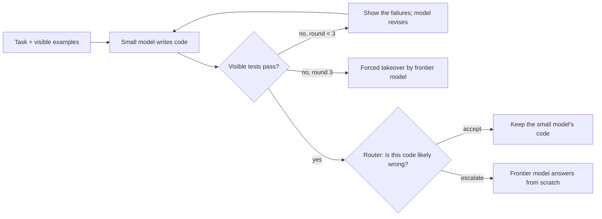

# System 1 Powered SLM

When should a small model ask for help? A small thinking model (Qwen3-1.7B) writes code for a task, runs it on the few visible example tests, and revises it for at most 3 rounds. When its code passes the visible tests, a cheap "System One" router predicts whether the code will still fail the hidden tests, and decides whether to accept the code or hand the task to a frontier model (Claude Sonnet 5.5). The router uses cheap loop features and zero-shot typed judgments from Jev (TypeSafe).

**Status:** the study is complete and all numbers are final (October 18, 2026). This README gives the hypotheses, the research approach, the data and the test results. The full protocol, every table, the glossary, the deviations, the timeline and the commands that recompute each number are in [docs/review-guide.md](docs/review-guide.md). The frozen plan is [docs/research-plan.md](docs/research-plan.md).

Key terms: **AUROC** is the chance that a randomly chosen failing checkpoint gets a higher score than a randomly chosen passing one (0.5 = chance, 1.0 = perfect). **LR** is logistic regression. A **checkpoint** is one round of one attempt. **Visible-pass** means the code passes the visible tests. **Dev / test** are the 40% / 60% task split: dev tasks built everything, test tasks were used once.

## Contents

1. [Hypotheses](#1-hypotheses)
2. [Research approach](#2-research-approach)
3. [Data collected](#3-data-collected)
4. [Test results](#4-test-results)
5. [Limitations](#5-limitations)

## 1. Hypotheses

Population: visible-pass checkpoints of the held-out test tasks. Outcome: the checkpoint's code fails the hidden EvalPlus tests. Both hypotheses were frozen before any test trajectory existed (git tag `protocol-freeze-v1`).

### Confirmatory hypotheses (Holm correction over the two, familywise α = 0.05)

| | Hypothesis | Contrast (same checkpoints) | Result | Verdict |
| --- | --- | --- | --- | --- |
| **H1** (primary) | Jev's typed answers add failure signal beyond the cheap loop features. | cheap + Jev (code + thinking answers) − cheap, both L2 LRs | ΔAUROC **+0.044** (+0.020 to +0.068), Holm p = 0.0006 | **Supported** |
| **H2** (secondary) | Jev's answers about the small model's thinking add signal beyond its answers about the code. | cheap + code + thinking − cheap + code | ΔAUROC **−0.012** (−0.021 to −0.004), Holm p = 0.010 | **Not supported**: the difference is in the opposite direction |

Both tests are two-sided. Jev is a zero-shot feature extractor; the predictor (the LR) is supervised and fit on dev tasks only. Following the plan, a negative H2 means "this budgeted trace view added no value in this pipeline", not "the reasoning has no useful information".

### Prespecified descriptive questions (no hypothesis test)

- **Q1 Escalation value:** at matched frontier-call budgets, does a router's ranking raise the final pass rate compared with random escalation? (offline replay)
- **Q2 Cost:** what does each policy cost per attempt, compared with always-small and always-frontier?
- **Q3 Other cheap judges:** how do the Jev routers compare with Pinocchio-0.8B (an open correctness estimator) and the small model's own logprob confidence?
- **Q4 Transfer (Amendment A1.1):** does an LR fit on one benchmark's dev tasks still rank failures on the other benchmark?

The study does not claim that Jev "detects drift", and it does not compare itself with verifiers measured on other populations (for example CodeMonitorBench).

### Hypotheses for a follow-up study (proposed after the results; not frozen)

These come from exploratory results of this study, so this data set cannot test them. They need new tasks and a new frozen protocol.

- **F1:** on the visible-pass checkpoints of a new benchmark, Jev's raw `code_likely_fails` probability, with no fitting, has a higher AUROC than the cheap-feature LR fit on that benchmark's dev tasks. Basis: the exploratory +0.137 in [section 4.6](#46-exploratory-chosen-after-seeing-the-results). Closest prior work: JevCoder (Jev on SWE-bench patches, AUROC 0.56–0.60, no visible-pass filter).
- **F2 (question):** how does Jev compare, in AUROC and in cost, with other checkers asked the same question: one frontier model, one open 7–8B model and Kev-0.8B (an open 0.8B code judge)? The cheap LR, the LR + Jev, Pinocchio and the logprob score repeat for continuity.

## 2. Research approach

1. **Tasks and split.** 542 Python tasks: 164 from HumanEval+ and 378 from MBPP+. Each has a description, a few visible examples and a large hidden EvalPlus test suite. The tasks were split once by task, stratified by benchmark: 217 dev and 325 test.
2. **The small model.** Qwen3-1.7B in thinking mode on a local RTX 3070 (vLLM; temperature 0.6, top-p 0.95, top-k 20; thinking cap 8,192 tokens). 5 independent attempts per task. Each round, it writes code and the code runs on the visible examples in a sandbox without network access. If the examples fail, the next round gets the previous code and the failure messages (not the previous thinking). The attempt ends at a visible pass or after round 3.
3. **Labels.** After generation, a separate grader ran every checkpoint's code on the full hidden suite (EvalPlus 0.3.1). The model and the routers never saw these results.
4. **The decision point.** Each attempt that passes its visible tests reaches one decision: accept or escalate. These visible-pass checkpoints are the population of H1 and H2.
5. **Signals.**
   - **Cheap features** (no extra cost): visible-test results, round, code length, thinking length and cap hit, repeat signals, and logprob summaries.
   - **Jev** (about $0.0001 per question set; returns P(yes) for fixed yes/no questions). Each checkpoint gets two calls. The *history call* sees the task, the code and the test output, and asks 3 code questions. The *trace call* also sees the current round's thinking, and asks the same 3 code questions plus 6 thinking questions.

     | Question | Call | Applies at a visible pass |
     | --- | --- | --- |
     | `code_likely_fails`: is the code likely to fail on valid inputs beyond the visible tests? | both | always |
     | `special_cases_visible_tests`: does the code special-case the visible inputs? | both | always |
     | `repeats_previous_code` | both | rounds 2–3 |
     | `on_task`: is the model working on the stated problem? | trace | always |
     | `unsupported_claim`: does the thinking claim something the evidence does not support? | trace | always |
     | `repeating_failed_fix`, `approach_change_without_evidence`, `stated_fix_matches_change` | trace | rounds 2–3 |
     | `clear_next_step` | trace | never |

   - **Other judges:** Pinocchio-0.8B (score = 1 − p_correct) and the logprob tail confidence of the last ≤ 1,024 thinking tokens.
6. **Routers** (all fit or selected on dev data only):
   - **Cheap LR**, **cheap + code** (+ the 3 history-call code answers) and **cheap + code + thinking** (+ the 5 applicable trace-call thinking answers). Pipeline: standard scaling, then L2 LR with C = 1, no tuning, fit on the 470 dev visible-pass checkpoints.
   - **Strong4 mean** (no fitting): the plain average of 4 Jev answers selected on dev data (`code_likely_fails`, `special_cases_visible_tests`, 1 − `on_task`, `unsupported_claim`), and **cheap + strong4**, the LR with the same 4 answers.
7. **Freeze.** Before the first test task ran, the routers, weights, escalation thresholds, both tests and the analysis rules were fixed (tag `protocol-freeze-v1`). Two amendments followed, both before any test code was graded: A1 added the transfer analysis, and A2 removed one task (HumanEval/32), because its EvalPlus oracle cannot pass any solution.
8. **Measurement 1: ranking.** AUROC on the visible-pass test checkpoints. H1 and H2 use a two-sided paired bootstrap that resamples whole tasks within benchmark (19,999 replicates), with Holm correction. Descriptive intervals use 2,000 task-bootstrap draws.
9. **Measurement 2: replay.** A simulation of each policy on the logged test runs, with no new model calls. At each visible pass, the router accepts or escalates at its frozen dev threshold for a budget of 10%, 25% or 50% of decisions. An escalated attempt gets the mean graded outcome of 3 frontier answers for its task (the frontier model answers from scratch). The comparators are always-small, forced-only (escalate only after 3 failed rounds), always-frontier, random escalation at the same rate, and an oracle. Cost uses two views: electricity at $0.15/kWh, and the GPU time priced at a cloud A10G rate of $1.006/h (a hypothetical normalization).

## 3. Data collected

| Run | What | Size |
| --- | --- | --- |
| `pilot-v1`, `pilot-v1b` (dev) | 217 dev tasks | 505 attempts, 621 checkpoints; 470 visible-pass, with 116 hidden fails from 49 tasks |
| `main-test-v1` (test) | 325 test tasks × 5 attempts | 1,625 attempts, 2,098 checkpoints |
| after Amendment A2 | HumanEval/32 removed | 324 tasks, 1,620 attempts, 2,086 checkpoints |
| Jev scoring (test) | 2 calls per checkpoint | 4,196 calls, all valid on the first try (`jev-1.13.0`) |
| `frontier-test-v1` | 324 tasks × 3 frontier answers | 972 answers: 878 pass, 94 fail |

**Test population for H1 and H2:** 1,457 visible-pass checkpoints from 309 tasks. 280 of them (19.2%) fail the hidden tests, from 89 tasks.

| Subset | Checkpoints | Hidden fails | Tasks with a fail |
| --- | --- | --- | --- |
| HumanEval+ | 450 | 51 | 18 |
| MBPP+ | 1,007 | 229 | 71 |
| Round 1 / 2 / 3 | 1,346 / 82 / 29 | 239 / 28 / 13 | — |

Raw runs (trajectories, hidden labels, Jev and Pinocchio records) are not in git. Aggregate result files are in [docs/results/](docs/results/).

## 4. Test results

### 4.1 Planned tests (H1, H2)

| Test | Contrast | ΔAUROC | 95% CI (unadjusted) | p | Holm p |
| --- | --- | --- | --- | --- | --- |
| H1 (primary) | cheap + code + thinking − cheap | +0.044 | +0.020 to +0.068 | 0.0003 | **0.0006** |
| H2 (secondary) | cheap + code + thinking − cheap + code | −0.012 | −0.021 to −0.004 | 0.0103 | **0.0103** |

### 4.2 Failure prediction on the visible-pass test checkpoints (descriptive)

| Router | Kind | AUROC (95% CI) | AUPRC | Miss rate at 5% false alarms |
| --- | --- | --- | --- | --- |
| Cheap LR | baseline | 0.689 (0.629–0.746) | 0.366 | 0.786 |
| Cheap + code | LR + Jev | 0.744 (0.687–0.799) | 0.474 | 0.725 |
| Cheap + code + thinking | LR + Jev (H1) | 0.732 (0.674–0.788) | 0.454 | 0.732 |
| Cheap + strong4 | LR + Jev | 0.731 (0.673–0.787) | 0.455 | 0.743 |
| Strong4 mean | Jev only, no LR | **0.816** (0.765–0.860) | 0.527 | 0.729 |
| Pinocchio-0.8B | other judge | 0.644 (0.581–0.708) | 0.302 | 0.907 |
| Logprob tail confidence | other signal | 0.663 (0.598–0.721) | 0.320 | 0.846 |

AUPRC for a random score is 0.192. By benchmark (HumanEval+ / MBPP+): cheap LR 0.730 / 0.706, cheap + code + thinking 0.751 / 0.745, strong4 mean 0.777 / 0.825. Within a task (47 tasks with both outcomes): cheap LR 0.504, cheap + code 0.571, strong4 mean 0.661.

### 4.3 Each Jev answer alone (prespecified audit)

| Question | Call | Checkpoints | AUROC |
| --- | --- | --- | --- |
| `code_likely_fails` | history / trace | 1,457 | 0.826 / 0.807 |
| `special_cases_visible_tests` | history / trace | 1,457 | 0.758 / 0.698 |
| `on_task` (bad = false) | trace | 1,457 | 0.765 |
| `unsupported_claim` | trace | 1,457 | 0.716 |
| Round 2–3 questions | trace | 111 | 0.66–0.76 (`repeats_previous_code` 0.46–0.50) |

The same code question, asked with the thinking, ranked failures less well: `code_likely_fails` −0.019 (−0.056 to +0.017), `special_cases_visible_tests` −0.060 (−0.104 to −0.016).

### 4.4 Escalation replay (descriptive)

Final hidden pass over all 1,620 test attempts. Gain vs random is in percentage points, against random escalation at the same realized rate.

| Policy | Budget | Pass | Frontier calls / attempt | Gain vs random (95% CI) | $ / attempt, electricity | $ / attempt, cloud (hypothetical) |
| --- | --- | --- | --- | --- | --- | --- |
| Always small | — | 0.730 | 0 | — | 0.00015 | 0.00634 |
| Forced-only | — | 0.807 | 0.101 | — | 0.00052 | 0.00671 |
| Always frontier | — | 0.903 | 1 | — | 0.00196 | 0.00196 |
| Oracle (upper bound) | — | 0.925 | 0.219 | — | 0.00078 | 0.00697 |
| Cheap LR | 25% / 50% | 0.849 / 0.873 | 0.293 / 0.514 | +2.2 (+0.8 to +3.5) / +2.2 (+0.7 to +3.6) | 0.00101 / 0.00146 | 0.00720 / 0.00765 |
| Cheap + code | 25% / 50% | 0.858 / 0.884 | 0.331 / 0.525 | +2.7 (+1.2 to +4.2) / +3.1 (+1.6 to +4.6) | 0.00113 / 0.00150 | 0.00732 / 0.00769 |
| Cheap + code + thinking | 25% / 50% | 0.856 / 0.883 | 0.316 / 0.530 | +2.6 (+1.1 to +4.2) / +3.0 (+1.4 to +4.5) | 0.00121 / 0.00162 | 0.00740 / 0.00781 |
| Strong4 mean | 25% / 50% | 0.867 / 0.893 | 0.328 / 0.542 | +3.6 (+1.9 to +5.3) / +3.9 (+2.5 to +5.3) | 0.00121 / 0.00161 | 0.00740 / 0.00780 |
| Pinocchio-0.8B | 25% / 50% | 0.845 / 0.865 | 0.322 / 0.506 | +1.4 (+0.0 to +2.9) / +1.5 (+0.0 to +2.9) | 0.00099 / 0.00134 | 0.00718 / 0.00753 |

The 10% budget, rescues and harms, a fixed-budget ranking view and the cost parts are in [docs/review-guide.md](docs/review-guide.md#escalation-replay-descriptive).

### 4.5 Transfer between benchmarks (Amendment A1.1, descriptive)

Jev increment (cheap + code + thinking − cheap) when the LRs are fit on one benchmark's dev tasks:

| Test rows | Fit on HumanEval+ dev | Fit on MBPP+ dev |
| --- | --- | --- |
| MBPP+ (71 fail tasks) | +0.115 (+0.067 to +0.165) | +0.015 (−0.011 to +0.040) |
| HumanEval+ (18 fail tasks; below the 30-task rule, sparse) | +0.109 (+0.019 to +0.218) | +0.004 (−0.018 to +0.029) |

The two training sets differ in size (147 and 323 rows). This tests the transfer of LR weights, not of question selection.

### 4.6 Exploratory (chosen after seeing the results)

| Comparison | ΔAUROC (95% CI) |
| --- | --- |
| raw `code_likely_fails` − cheap LR | +0.137 (+0.078 to +0.195) |
| raw `code_likely_fails` − Pinocchio-0.8B | +0.182 (+0.109 to +0.250) |
| raw `code_likely_fails` − logprob tail confidence | +0.163 (+0.100 to +0.226) |
| strong4 mean − cheap LR | +0.127 (+0.078 to +0.177) |

Checks of the H2 result (cap-hit, looping, long and short traces, request sizes) found no single explanation. Details: [docs/review-guide.md](docs/review-guide.md#exploratory-analyses-after-the-planned-analysis).

### 4.7 What the results show

1. **H1 is supported.** Jev's answers raise the cheap LR's AUROC from 0.689 to 0.732. Most of the gain comes from the 3 code questions (cheap + code: 0.744).
2. **H2 is not supported.** Adding the thinking answers lowered the LR's AUROC by 0.012. The thinking answers alone still rank failures (`on_task` 0.765, `unsupported_claim` 0.716), but they also see the code, so the contrast cannot isolate "reading the thinking".
3. **Jev without an LR ranked best, but this is not confirmatory.** The strong4 mean (0.816, descriptive) and the raw `code_likely_fails` (0.826, exploratory) beat every LR, including the LRs that contain the same answers (0.731–0.744). The small dev set (116 failures) is one possible reason, not an established one. F1 tests this on new tasks.
4. **Routing helps a little (Q1).** At 25% and 50% budgets, the LR and Jev routers beat random escalation by +2.2 to +3.9 points; Pinocchio by +1.4 to +1.5. At about half the frontier calls, the H1 router reaches 88.3% vs 90.3% for always-frontier.
5. **Cost depends on the view (Q2).** One frontier takeover costs about $0.002. With electricity cost only, every policy in the table costs less than always-frontier. With the cloud GPU price, every small-model policy costs more than always-frontier.
6. **The other cheap judges are weaker (Q3).** Pinocchio-0.8B (0.644) and the logprob score (0.663) rank failures less well than the cheap LR (0.689).
7. **Transfer (Q4)** is mixed: the HumanEval+-fit LRs show a large Jev increment on both targets, the MBPP+-fit LRs a small one.

## 5. Limitations

- One small generator with an 8K thinking cap, one frontier model, and two older benchmarks that the models may have seen in training.
- The LRs were fit on 470 dev checkpoints with 116 failures, so their weights are noisy.
- HumanEval+ has only 18 tasks with a visible-pass failure.
- The trace call differs from the history call in the thinking and in the number of questions (9 vs 3).
- Jev is a closed model with a version that cannot be pinned, two-decimal probabilities and an unconfirmed price.
- The highest single AUROC (0.826) was selected after seeing the results.
- Small-model energy for hypothetical policies is allocated by tokens; one run session's energy was rebuilt from power samples. The cloud cost view is a normalization, not a measured cloud run.

## Repository layout

| Path | Contents |
| --- | --- |
| `docs/` | Full review guide, frozen plan, dev findings, aggregate results (`docs/results/`) |
| `configs/` | Split, visible tests, Jev questions, frozen routers, amendments, exclusions, prices |
| `src/system1/` | Loop, features, Jev and Pinocchio clients, frontier client, labels, predictors, statistics, replay |
| `scripts/` | Runs, grading, scoring, analyses (`scripts/analysis/` holds the exploratory ones) |
| `docker/`, `tests/`, `research/` | Images, unit tests (`uv run pytest`), literature notes |

Secrets go in `.env` (copy `.env.example`); it is git-ignored.
