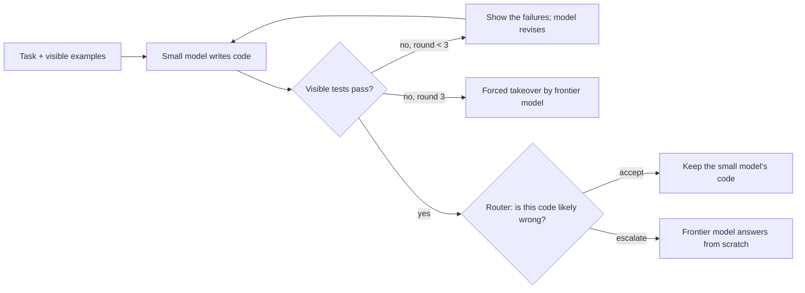

# When Should a Small Model Ask for Help? Typed Judges for Hidden-Test Failure in a Small Model's Repair Loop

**Status:** the study is complete and all numbers are final (October 18, 2026). This README is written as the paper draft. The full protocol, every table, the glossary, the timeline and the reporting checklist are in [docs/review-guide.md](docs/review-guide.md). The frozen plan is [docs/research-plan.md](docs/research-plan.md); the development-phase results are in [docs/findings.md](docs/findings.md). **Every thinking trace of the test run**, with the code, the visible-test report and the hidden-test result of each round, is in [docs/traces/](docs/traces/README.md); its index marks each task by how the small model did alone.

## Abstract

A small model that writes code can check its work only against the few visible tests in the prompt, and code that passes them can still be wrong. We ask whether a cheap router can find such code at the moment it passes, so that only those tasks go to a frontier model. Qwen3-1.7B (thinking mode, 8K thinking cap) works in a write → test → revise loop, 5 attempts per task; we analyze 324 retained held-out HumanEval+ and MBPP+ tasks. Of its 1,457 visible-pass checkpoints, 19.2% fail the hidden EvalPlus tests. In a preregistered test, adding zero-shot typed judgments from Jev (TypeSafe) to a logistic regression on cheap loop features raised AUROC from 0.689 to 0.732 (ΔAUROC +0.044, Holm p = 0.0006). A second preregistered test found the opposite of its hypothesis: adding Jev's judgments of the model's reasoning to its judgments of the code lowered AUROC by 0.012 (Holm p = 0.010). Descriptively, an unfitted average of four Jev answers reached AUROC 0.816, while Pinocchio-0.8B (0.644) and a logprob confidence score (0.663) had lower observed AUROC than the cheap baseline. In an offline replay at 25% and 50% escalation budgets, routers beat random escalation at the same rate by 1.4 to 3.9 points of final hidden pass, but the Jev router beat the cheap router by only 0.2 to 0.9 points at identical 10% to 50% budgets. At about half the frontier calls, the primary router reached 88.3% against 90.3% for always-frontier. The displayed cascades cost less than always-frontier when the local GPU is charged only for its electricity (plus API charges), and more when its time is priced at a cloud rate.

## Contents

1. [Introduction](#1-introduction)
2. [Related work](#2-related-work)
3. [Hypotheses](#3-hypotheses)
4. [Method](#4-method)
5. [Data collected](#5-data-collected)
6. [Results](#6-results)
7. [Discussion](#7-discussion)
8. [Preregistration, deviations and integrity](#8-preregistration-deviations-and-integrity)
9. [Limitations](#9-limitations)
10. [Conclusion](#10-conclusion)
11. [Future work](#11-future-work)
12. [Reproducibility, compute and data availability](#12-reproducibility-compute-and-data-availability)
13. [References](#13-references)

Key terms: **AUROC** is the chance that a randomly chosen failing checkpoint gets a higher score than a randomly chosen passing one, with ties counted as one half (0.5 = chance, 1.0 = perfect). **LR** is logistic regression. A **checkpoint** is one round of one attempt. **Visible-pass** means the code passes the visible tests. **Dev / test** are the 40% / 60% task split: dev tasks built everything, and test tasks were used once. All other terms: [glossary](docs/review-guide.md#glossary).

## 1. Introduction

Small open models need far fewer resources than frontier models and can run on local hardware, but they make more errors. A natural design is a cascade: the small model does the work, and a router sends only the hard cases to a frontier model. For code, the small model can run the visible example tests in the task. When they fail, the decision is easy: the model revises or escalates. When they pass, a rule that reads only the visible tests has nothing left to separate, but in our test data **one in five** visible-pass checkpoints still fails the hidden tests. This is the decision we study.

"System One" models such as Jev answer typed questions (here yes/no) with a probability, without writing text, at a very low price. In one earlier evaluation of routing from the prompt alone, Jev called almost every request "cheap" and another System One model ranked at chance (Li, 2026), but the same work found that they judge evidence better. On general answer correctness, Jev was weaker than the trained calibrator Pinocchio (AUROC 0.666 vs 0.868 for the paper's 8B calibrator, on question-answer pairs; Pinocchio, Appendix E.10). A small model's partial attempt carries evidence: its code, the visible-test output, its repair history and its reasoning. So a typed judge may judge an attempt even though it cannot predict difficulty from a prompt.

We ask two questions. Do Jev's typed judgments add hidden-failure signal beyond cheap loop features, on exactly the checkpoints that visible tests cannot separate? And do typed judgments about the small model's reasoning add signal beyond cheap features and typed judgments about its code?

**Contributions.**

1. A preregistered test, on held-out tasks, of whether a zero-shot typed judge adds hidden-failure signal beyond cheap loop features in the visible-pass population. It does: +0.044 AUROC.
2. A preregistered test of whether adding the judge's answers about the reasoning improves prediction beyond cheap features and its answers about the code. The result is negative: the reasoning answers lowered AUROC in the frozen pipeline.
3. An offline replay of escalation at matched frontier-call budgets, against random escalation, forced-only, always-frontier and an oracle, with costs under two named views.
4. The code, the frozen configurations and the aggregate results, with the confirmatory, descriptive and exploratory results kept apart.

We do not claim to be the first at visible-pass monitoring, at trajectory-based code routing, or at using Jev as a correctness judge (see [Related work](#2-related-work)).

## 2. Related work

**Code that passes its public tests.** CodeMonitorBench [2] uses the same visible-pass / hidden-fail framing: LLM verifiers look for hidden bugs in code that passed the public tests (7–8B open verifiers AUROC 0.54–0.67, GLM-5.1 0.83). It has no reasoning trace, no repair history and no cost analysis. Model Cascading for Code [12] escalates with self-generated tests.

**Routing from partial trajectories.** SWE-Router [3] trains a value head on a 7B coder to read a cheap agent's partial trajectory and continue or restart with a strong model, on SWE-bench. R2V-Agent [8] routes step by step from a small to a large agent, including HumanEval+, with cost as the share of steps escalated. STEPGATE [11] hands off from a 1.5B to a 7B model on function calling. The Handoff Tax [13] finds, on repository-level SWE-bench agents, that escalating with the weak model's full trajectory recovers less than half the quality gap; this motivates our takeover from scratch, but does not establish it for function-level tasks. Background: FrugalGPT, RouteLLM, AutoMix and a routing survey [17]. Bayesian Self-Escalation [10] gives a theory of escalation during generation.

**Reasoning traces as evidence.** Thought-tree features of reasoning traces predict coding correctness for frontier reasoning models (Playing Psychic [4]). Faithfulness as Information Flow [9] finds that RL-trained models often stop saying in their reasoning that they hard-code visible tests, a direct risk for trace questions. Structural Baselines Matter [6] and Automata from Agent Traces [15] show that content-blind features can beat LLM judges, so our cheap baseline includes length and repeat features.

**Jev and typed judges.** Fast Models, Slow Evidence [1] is our motivating null result for routing from the prompt. Just Ask Jev [14] finds that one generic Jev question detects many alignment failures (median AUROC 0.886). JevCoder [18] asks Jev whether a SWE-bench patch passes its tests (AUROC 0.56–0.60, no visible-pass filter). JEV-as-a-Judge [19] reports pairwise judgments, including MBPP-Plus pairs (Jev 66.2% vs GPT-6 78.8%). A LessWrong pilot [20] uses Jev to find planted backdoors in test-passing APPS code (AUROC 0.97–0.98), not natural bugs. Pinocchio [5] is a trained black-box correctness calibrator and one of our comparators. Kev-0.8B code-verify-v2 [21] is an open 0.8B typed judge trained on HumanEvalPack hidden-test labels (AUROC 0.970, no visible-pass filter).

**Our position.** We hold the population fixed at visible-pass checkpoints of a 1.7B thinking model. In preregistered tests, we ask whether a zero-shot typed judge adds signal beyond a cheap-feature baseline, and whether its judgments about the reasoning add signal beyond its judgments about the code. Then we measure what the judge buys under matched frontier budgets.

## 3. Hypotheses

Population: visible-pass checkpoints of the held-out test tasks. Outcome: the checkpoint's code fails the hidden EvalPlus tests. Both hypotheses were frozen before any test trajectory existed (git tag `protocol-freeze-v1`).

### Confirmatory hypotheses (Holm correction over the two, familywise α = 0.05)

| | Hypothesis | Contrast (same checkpoints) | Result | Verdict |
| --- | --- | --- | --- | --- |
| **H1** (primary) | Jev's typed answers add failure signal beyond the cheap loop features. | cheap + Jev (code + thinking answers) − cheap, both L2 LRs | ΔAUROC **+0.044** (+0.020 to +0.068), Holm p = 0.0006 | **Supported** |
| **H2** (secondary) | Jev's answers about the small model's thinking add signal beyond its answers about the code. | cheap + code + thinking − cheap + code | ΔAUROC **−0.012** (−0.021 to −0.004), Holm p = 0.010 | **Not supported**: the difference is in the opposite direction |

Both tests are two-sided. Jev is a zero-shot feature extractor; the predictor (the LR) is supervised and fit on dev tasks only. Following the plan, a negative H2 means "this budgeted trace view added no value in this pipeline", not "the reasoning has no useful information". The plan asked for a practically meaningful gain to be fixed in advance; the frozen files record no such number, so the results are reported against zero.

### Prespecified descriptive questions (no hypothesis test)

- **Q1 Escalation value:** at matched frontier-call budgets, does a router's ranking raise the final pass rate compared with random escalation?
- **Q2 Cost:** what does each policy cost per attempt, compared with always-small and always-frontier?
- **Q3 Other cheap judges:** how do the Jev routers compare with Pinocchio-0.8B and the small model's own logprob confidence?
- **Q4 Transfer (Amendment A1.1):** does an LR fit on one benchmark's dev tasks still rank failures on the other benchmark?

The study does not claim that Jev "detects drift", and it does not claim to beat verifiers measured on other populations.

### Status of each claim

| Claim | Status |
| --- | --- |
| H1, H2 | **Confirmatory**: frozen before test generation, Holm over the two |
| Table 2, per-answer audit, same-question contrast, operating points, replay | Descriptive, prespecified |
| Strong4 mean and cheap + strong4 | Descriptive; selected on dev data after the predictor freeze, frozen before any test trajectory |
| Transfer | Descriptive; specified in Amendment A1 before any test label |
| Raw `code_likely_fails` against the other scores; diagnostics of the same-question comparison | **Exploratory**: chosen after seeing the test results |

## 4. Method

*Figure 1: the loop and the decision point that the routers face.*

### 4.1 Tasks and split

542 Python tasks: 164 from HumanEval+ and 378 from MBPP+ (EvalPlus [22]). One fixed 40/60 split by task, stratified by benchmark (seed 20261016), gives 217 dev and 325 test tasks. Dev tasks fit the LRs, set the thresholds and ran the gates. The test outputs and labels stayed unopened until the protocol was frozen.

### 4.2 Generation

| Item | Value |
| --- | --- |
| Small model | Qwen3-1.7B [23], `Qwen/Qwen3-1.7B` at revision `70d244cc`, thinking mode, vLLM on one RTX 3070 (8 GB) |
| Sampling | temperature 0.6, top-p 0.95, top-k 20; thinking cap 8,192 tokens, answer limit 2,048, context 16,384; fixed per-request seeds (vLLM batching makes runs not bit-reproducible) |
| Loop | Round 1: instruction + task + visible tests. The code runs on the visible tests in a sandbox without network access. At a visible pass, or after round 3, the attempt ends. Otherwise the next round gets the task, the previous code and its test output, never the previous thinking. |
| Attempts | Test: 5 per task. Dev: attempt 0 on all 217 tasks, attempts 1–4 on a seeded one-third subsample (72 tasks). |
| Frontier model | `anthropic/claude-sonnet-5.5-20260928` through OpenRouter, provider pinned with no fallbacks, low reasoning effort, max 8,000 output tokens, provider-default temperature. Takeover from scratch: the prompt is the small model's round-1 message. 3 independent answers per task. |

### 4.3 Visible tests and labels

The visible tests are exactly the examples the model sees: the one `assert` line in an MBPP+ prompt, and the `>>>` docstring examples in HumanEval+ (for a task without a usable example, the first three original inputs with their outputs). The label is whether the code fails the full EvalPlus 0.3.1 suite (base + plus inputs), so the grading suite can contain the visible examples. What the model and Jev never see are the other grading inputs and all grading outcomes. A separate grader, with vLLM stopped, graded every code twice (a third time on disagreement) after it calibrated every reference solution. Two HumanEval tasks have wrong docstring examples (HumanEval/47 and /116); they stay, because the model sees them, and they explain 21 of the 22 visible-fail checkpoints that pass the grading suite. Visible-fail checkpoints are not in the H1/H2 population. They stay in the replay: an attempt that still fails after round 3 is a forced takeover for every policy except always-small. Hidden labels of dev tasks were used to fit the LRs and set thresholds; at inference, no router sees any hidden outcome, and no test label was read before the analysis.

### 4.4 Signals

- **Cheap features** (no extra cost): round, visible pass fraction, visible not-run count, code lines, "wait"-marker count, log thinking tokens; logprob summaries (thinking mean logprob, tail confidence, bottom-10% group confidence, answer mean logprob); visible pass, cap hit, thinking closed, loop flag, code missing; five history numbers (pass-count change, code similarity, same error, same failing tests, return to earlier code); error type.
- **Jev** (`jev-1.13.0` throughout; P(true) with two decimals; about $0.0001 per call). Each checkpoint gets two calls on one shared base state: the task, the current code, the visible-test output and six loop-telemetry numbers.
  - The **history call** adds the previous code and its test output (rounds 2–3), and asks the 3 code questions.
  - The **trace call** adds the current round's thinking (head and tail kept under a 56,000-byte budget; no 8K trace needed a cut), and asks the same 3 code questions plus 6 thinking questions.
  - The questions ([configs/rubric_v2.yaml](configs/rubric_v2.yaml)) were frozen before the pilot, with written true and false criteria.

  | Question | Call | Applies at a visible pass | Bad answer |
  | --- | --- | --- | --- |
  | `code_likely_fails`: Is the current code likely to fail on valid inputs beyond the visible tests? | both | always | true |
  | `special_cases_visible_tests`: Does the code special-case the visible test inputs instead of solving the task? | both | always | true |
  | `repeats_previous_code`: Is the current code essentially the same as the previous attempt? | both | rounds 2–3 | true |
  | `on_task`: Is the model working on the assigned problem as it is stated? | trace | always | false |
  | `unsupported_claim`: Does the thinking make a claim that the evidence does not support? | trace | always | true |
  | `repeating_failed_fix`: Is the model repeating a fix that already failed? | trace | rounds 2–3 | true |
  | `approach_change_without_evidence`: Does the model change approach without new evidence? | trace | rounds 2–3 | true |
  | `stated_fix_matches_change`: Does the code change match the fix the thinking describes? | trace | rounds 2–3 | false |
  | `clear_next_step`: Does the model have a clear next step? | trace | never | false |

- **Pinocchio-0.8B** [5]: base `Qwen/Qwen3.5-0.8B` with adapter `KevinDavidHayes/pinocchio-0.8b` at pinned revisions, package `pinocchio-uq==0.1.1` defaults ("combined" prompt; the question is cut at 1,500 and the answer at 800 characters), on CPU. Score = 1 − p_correct. Input: the round-1 task message as the question and the answer text after the thinking as the answer (input-v2, with the executed code as the answer, is a sensitivity: 0.613).
- **Logprob tail confidence** (adapted from DeepConf [24]; `predict.logprob_comparator`): for each of the last ≤ 1,024 thinking tokens, minus the mean of its top-5 logprobs; then the mean over those tokens, negated so that a higher value means more likely to fail.

### 4.5 Routers

All routers were fit or selected on dev data only.

- **Cheap LR**, **cheap + code** (+ the 3 history-call code answers) and **cheap + code + thinking** (+ the 5 trace-call thinking answers that can apply at a visible pass; the H1 router). Pipeline: standard scaling, then L2 LR with C = 1 (not tuned), refit once on all 470 dev visible-pass checkpoints (205 tasks; 116 hidden fails from 49 tasks). Structural missing values (for example history features in round 1) are zero-filled with shared indicators.
- **Strong4 mean** (no fitting): (p(`code_likely_fails`) + p(`special_cases_visible_tests`) + (1 − p(`on_task`)) + p(`unsupported_claim`)) / 4, with the two code answers from the history call and the two thinking answers from the trace call. A structurally unavailable answer counts as 0.5. **Cheap + strong4** is the LR with the same four answers.

### 4.6 Statistics

- **H1 and H2:** ΔAUROC on the same checkpoints, with a two-sided paired bootstrap centered on the null (Hall and Wilson [7]): 19,999 replicates that resample whole test tasks within benchmark, with all their rows and both scores. p = (1 + #{|Δ\* − Δ̂| ≥ |Δ̂|}) / (B + 1), then Holm [16] over the two tests. The 95% intervals are percentile intervals of Δ\* and are not adjusted for multiplicity.
- **Other paired comparisons** (transfer gaps and Jev increments, the exploratory raw-answer comparisons) use the same benchmark-stratified bootstrap with 19,999 replicates; the transfer intervals are conditional on the fitted models.
- **Descriptive intervals** (Table 2, the per-answer audit, the same-question contrast): 2,000 whole-task bootstrap draws over fixed scores, not stratified by benchmark. So the same difference can have slightly different intervals in 6.2 and 6.7.
- **Pooled AUROC** counts every checkpoint once (the headline). **Task-weighted** AUROC gives each task the same weight. **Within-task** AUROC is the mean over the 47 tasks with both outcomes. **AUPRC** is computed as average precision.
- **Miss rate at 5% false alarms** (FNR at 5% FPR) uses the most permissive observed threshold on the test scores with FPR ≤ 5%, ties kept together, without interpolation. It is descriptive, not a deployment threshold.

### 4.7 Escalation replay and cost

- **Decisions.** The loop accepts a visible pass at once, so each attempt has at most one optional decision. An attempt that never passes is a forced takeover for every policy except always-small.
- **Thresholds.** For budgets of 10%, 25% and 50% of visible-pass decisions, each threshold is the weighted quantile of the router's dev scores: task-grouped out-of-fold predictions for the LRs (mean over 20 fold splits), and direct scores for the strong4 mean and Pinocchio. Each dev row has weight 1 / (sampled attempts of its task), because dev sampling is unequal. A score equal to the threshold escalates by a frozen hash of the checkpoint id. A missing Jev score would fall back to the cheap LR (never needed).
- **Outcome.** An escalated attempt gets the mean graded outcome of its task's 3 frontier answers. The same 3 answers serve every attempt of that task, so the replay is exact for the logged runs and the sampled answers, not a fresh live run.
- **Comparators.** Always-small, forced-only (escalate only after 3 failed rounds), always-frontier, random escalation at the same realized rate (closed form), and an oracle. For each frontier replicate, the oracle escalates a visible-pass checkpoint exactly when that replicate's answer passes and the small model's code fails; forced takeovers stay. So it can pass more than always-frontier with fewer calls.
- **Uncertainty.** Whole tasks resampled within benchmark, with all their attempts, frontier answers and scores.
- **Cost per attempt**, in two views:
  - *Electricity only:* measured GPU board energy at an assumed $0.15/kWh, plus API spend.
  - *Hypothetical cloud:* the RTX 3070 run time priced at the A10G on-demand rate of $1.006/h, plus API spend. It is a normalization, not a measured cloud run.
  - The small model's share of a run's energy and time is allocated by generated tokens. Jev dollars use a third-party price ($0.042 per million input tokens), not confirmed billing. Pinocchio's CPU time (about 2.0 s per decision) is not priced.

## 5. Data collected

| Run | What | Size |
| --- | --- | --- |
| `pilot-v1`, `pilot-v1b` (dev) | 217 dev tasks | 505 attempts, 621 checkpoints; 470 visible-pass, with 116 hidden fails from 49 tasks |
| `main-test-v1` (test) | 325 test tasks × 5 attempts | 1,625 attempts, 2,098 checkpoints |
| after Amendment A2 | HumanEval/32 removed | 324 tasks, 1,620 attempts, 2,086 checkpoints |
| Jev scoring (test) | 2 calls per checkpoint | 4,196 calls, all valid on the first try |
| `frontier-test-v1` | 324 tasks × 3 frontier answers | 972 answers: 878 pass, 94 fail |

**Thinking traces:** all 2,098 test checkpoints can be read in [docs/traces/](docs/traces/README.md): one page per task (the prompt and the visible tests) and one page per attempt (the thinking, the code, the visible-test report and the hidden-test result of each round). The index marks each task 🟢 (every attempt's final code passes the hidden tests), 🟡 (some fail) or 🔴 (all fail), and counts the attempts that pass the visible tests but fail the hidden ones. A machine-readable copy is [docs/traces/main-test-v1_traces.jsonl.gz](docs/traces/main-test-v1_traces.jsonl.gz). Jev and Pinocchio scores are not in these files.

**Test population for H1 and H2:** 1,457 visible-pass checkpoints from 309 tasks. 280 of them (19.2%) fail the hidden tests, from 89 tasks. A task can have both outcomes.

*Table 1: the test population.*

| Subset | Checkpoints | Hidden fails | Tasks with a fail | Tasks with a pass |
| --- | --- | --- | --- | --- |
| HumanEval+ | 450 | 51 | 18 | 86 |
| MBPP+ | 1,007 | 229 | 71 | 181 |
| Round 1 / 2 / 3 | 1,346 / 82 / 29 | 239 / 28 / 13 | — | — |

## 6. Results

### 6.1 Planned tests (H1, H2)

| Test | Contrast | ΔAUROC | 95% CI (unadjusted) | p | Holm p |
| --- | --- | --- | --- | --- | --- |
| H1 (primary) | cheap + code + thinking − cheap | +0.044 | +0.020 to +0.068 | 0.0003 | **0.0006** |
| H2 (secondary) | cheap + code + thinking − cheap + code | −0.012 | −0.021 to −0.004 | 0.0103 | **0.0103** |

### 6.2 Failure prediction on the visible-pass test checkpoints (descriptive)

*Table 2: all routers on the 1,457 test checkpoints.*

| Router | Kind | AUROC (95% CI) | Task-weighted | AUPRC | Miss rate at 5% false alarms | Brier |
| --- | --- | --- | --- | --- | --- | --- |
| Cheap LR | baseline | 0.689 (0.629–0.746) | 0.701 | 0.366 | 0.786 | 0.156 |
| Cheap + code | LR + Jev | 0.744 (0.687–0.799) | 0.755 | 0.474 | 0.725 | 0.138 |
| Cheap + code + thinking | LR + Jev (H1) | 0.732 (0.674–0.788) | 0.746 | 0.454 | 0.732 | 0.141 |
| Cheap + strong4 | LR + Jev | 0.731 (0.673–0.787) | 0.743 | 0.455 | 0.743 | 0.142 |
| Strong4 mean | Jev only, no LR | **0.816** (0.765–0.860) | 0.820 | 0.527 | 0.729 | — |
| Pinocchio-0.8B | other judge | 0.644 (0.581–0.708) | 0.664 | 0.302 | 0.907 | — |
| Logprob tail confidence | other signal | 0.663 (0.598–0.721) | 0.679 | 0.320 | 0.846 | — |

AUPRC for a random score is 0.192. Brier only for LR probabilities. The Pinocchio row uses input-v1; input-v2 (the executed code as the answer) scored 0.613. Descriptive Δ against the cheap LR: cheap + code +0.056 (+0.034 to +0.077); strong4 mean +0.127 (+0.077 to +0.177); Pinocchio −0.044 (−0.107 to +0.022); logprob −0.026 (−0.058 to +0.005).

By benchmark (HumanEval+ / MBPP+): cheap LR 0.730 / 0.706; cheap + code 0.751 / 0.758; cheap + code + thinking 0.751 / 0.745; strong4 mean 0.777 / 0.825; Pinocchio 0.565 / 0.672; logprob 0.717 / 0.677. Within a task (47 tasks): cheap LR 0.504, cheap + code 0.571, cheap + code + thinking 0.546, strong4 mean 0.661.

### 6.3 Each Jev answer alone (prespecified audit)

| Question | Call | Checkpoints | Fail tasks | AUROC |
| --- | --- | --- | --- | --- |
| `code_likely_fails` | history / trace | 1,457 | 89 | 0.826 / 0.807 |
| `special_cases_visible_tests` | history / trace | 1,457 | 89 | 0.758 / 0.698 |
| `on_task` (bad = false) | trace | 1,457 | 89 | 0.765 |
| `unsupported_claim` | trace | 1,457 | 89 | 0.716 |
| `repeating_failed_fix` | trace | 111 | 23 | 0.696 |
| `approach_change_without_evidence` | trace | 111 | 23 | 0.763 |
| `stated_fix_matches_change` (bad = false) | trace | 111 | 23 | 0.663 |
| `repeats_previous_code` | history / trace | 111 | 23 | 0.462 / 0.502 |

**The same question with and without the thinking** (prespecified, descriptive): `code_likely_fails` −0.019 (−0.056 to +0.017); `special_cases_visible_tests` −0.060 (−0.104 to −0.016); `repeats_previous_code` +0.041 (+0.005 to +0.080); the cheap + code LR with the code answers taken from the trace call instead of the history call −0.013 (−0.025 to −0.002).

### 6.4 Operating points at the frozen thresholds

Share escalated, realized false-alarm rate (FPR), miss rate (FNR) and the hidden-fail rate among accepted checkpoints (19.2% if none is escalated), at the 25% and 50% budgets:

| Router | Escalated | FPR | FNR | Fail rate among accepted |
| --- | --- | --- | --- | --- |
| Cheap LR | 0.213 / 0.460 | 0.168 / 0.408 | 0.596 / 0.321 | 0.146 / 0.114 |
| Cheap + code + thinking | 0.240 / 0.477 | 0.180 / 0.412 | 0.511 / 0.250 | 0.129 / 0.092 |
| Strong4 mean | 0.253 / 0.491 | 0.168 / 0.406 | 0.393 / 0.154 | 0.101 / 0.058 |
| Pinocchio-0.8B | 0.246 / 0.450 | 0.204 / 0.407 | 0.579 / 0.368 | 0.147 / 0.129 |

### 6.5 Escalation replay

*Table 3: final hidden pass over all 1,620 test attempts (mean over the 3 frontier answers). The budget is the nominal dev rate; "realized" is the share of test visible-pass decisions that the frozen threshold escalated. Gain is against random escalation at the same realized rate, in percentage points.*

| Policy | Budget | Realized | Pass | Frontier calls / attempt | Gain vs random (95% CI) | $ / attempt, electricity | $ / attempt, cloud (hypothetical) |
| --- | --- | --- | --- | --- | --- | --- | --- |
| Always small | — | — | 0.730 | 0 | — | 0.00015 | 0.00634 |
| Forced-only | — | 0 | 0.807 | 0.101 | — | 0.00052 | 0.00671 |
| Always frontier | — | — | 0.903 | 1 | — | 0.00196 | 0.00196 |
| Oracle (upper bound) | — | 0.131 | 0.925 | 0.219 | — | 0.00078 | 0.00697 |
| Cheap LR | 25% / 50% | 0.213 / 0.460 | 0.849 / 0.873 | 0.293 / 0.514 | +2.2 (+0.8 to +3.5) / +2.2 (+0.7 to +3.6) | 0.00101 / 0.00146 | 0.00720 / 0.00765 |
| Cheap + code | 25% / 50% | 0.256 / 0.472 | 0.858 / 0.884 | 0.331 / 0.525 | +2.7 (+1.2 to +4.2) / +3.1 (+1.6 to +4.6) | 0.00113 / 0.00150 | 0.00732 / 0.00769 |
| Cheap + code + thinking | 25% / 50% | 0.240 / 0.477 | 0.856 / 0.883 | 0.316 / 0.530 | +2.6 (+1.1 to +4.2) / +3.0 (+1.4 to +4.5) | 0.00121 / 0.00162 | 0.00740 / 0.00781 |
| Strong4 mean | 25% / 50% | 0.253 / 0.491 | 0.867 / 0.893 | 0.328 / 0.542 | +3.6 (+1.9 to +5.3) / +3.9 (+2.5 to +5.3) | 0.00121 / 0.00161 | 0.00740 / 0.00780 |
| Pinocchio-0.8B | 25% / 50% | 0.246 / 0.450 | 0.845 / 0.865 | 0.322 / 0.506 | +1.4 (+0.0 to +2.9) / +1.5 (+0.0 to +2.9) | 0.00099 / 0.00134 | 0.00718 / 0.00753 |

*Table 4: final hidden pass by benchmark. HumanEval+: 485 attempts from 97 tasks; MBPP+: 1,135 attempts from 227 tasks. "Small model alone" is the small model's final code after up to 3 rounds with visible-test feedback, averaged over the 5 attempts per task. Forced-only replaces the attempts that never pass the visible tests with the frontier outcome. Always-frontier is the mean of the 3 independent from-scratch frontier answers per task. The router rows use the frozen thresholds; their realized escalation rate differs by benchmark (shown in brackets).*

| Policy | Budget | HumanEval+ | MBPP+ | Both |
| --- | --- | --- | --- | --- |
| Small model alone (always-small) | — | 0.833 | 0.685 | 0.730 |
| Forced-only | — | 0.883 | 0.774 | 0.807 |
| Always frontier | — | 0.966 | 0.877 | 0.903 |
| Oracle (upper bound) | — | 0.980 | 0.902 | 0.925 |
| Cheap LR | 25% | 0.935 [0.26] | 0.813 [0.19] | 0.849 |
| Cheap LR | 50% | 0.943 [0.54] | 0.843 [0.43] | 0.873 |
| Cheap + code | 25% | 0.941 [0.30] | 0.823 [0.24] | 0.858 |
| Cheap + code | 50% | 0.945 [0.51] | 0.857 [0.46] | 0.884 |
| Cheap + code + thinking (H1) | 25% | 0.937 [0.28] | 0.822 [0.22] | 0.856 |
| Cheap + code + thinking (H1) | 50% | 0.943 [0.52] | 0.857 [0.46] | 0.883 |
| Strong4 mean | 25% | 0.926 [0.22] | 0.842 [0.27] | 0.867 |
| Strong4 mean | 50% | 0.945 [0.44] | 0.871 [0.51] | 0.893 |
| Pinocchio-0.8B | 25% | 0.914 [0.24] | 0.815 [0.25] | 0.845 |
| Pinocchio-0.8B | 50% | 0.926 [0.48] | 0.839 [0.44] | 0.865 |

At the 50% budget, the routers come within 2.1 to 4.0 points of always-frontier on HumanEval+ and within 0.6 to 3.8 points on MBPP+. On MBPP+, the Jev routers close more of the gap than the cheap LR (2.0 points for the H1 router, 0.6 for the strong4 mean, 3.4 for the cheap LR). The realized escalation rates differ by benchmark, so these are not matched-budget comparisons.

**Jev against the cheap router at identical budgets** (label-free top-k on the test scores, so both escalate exactly the same number of checkpoints): the H1 router passes 0.835 / 0.858 / 0.885 at 10% / 25% / 50%, and the cheap LR 0.833 / 0.849 / 0.877, a difference of +0.2 to +0.9 points (descriptive). The gain over random is mostly the cheap features' ranking; Jev adds a smaller part.

**Rescues and harms** count only optional escalations: a rescue escalates failing code and the frontier answer passes; a harm escalates passing code and the frontier answer fails. For the H1 router at 50%: 0.091 rescues and 0.015 harms per attempt.

**Variation across the 3 frontier answers:** the three replicates give 0.885 / 0.879 / 0.885 for the H1 router at 50%, and 0.907 / 0.898 / 0.904 for always-frontier.

**Cost boundaries.** The electricity view counts only GPU board energy and API spend; the cloud view prices the RTX 3070 run time at an A10G rate. Neither counts Pinocchio's CPU time, the host machine or engineering time, and the Jev price is an unconfirmed third-party price. Cost split for the H1 router at 50%, per attempt: small model $0.00015 (electricity) or $0.00634 (cloud), frontier $0.00132, Jev $0.00015.

At the 10% budget (frozen thresholds), the gains are smaller: +1.2 to +1.6 points for the LR and Jev routers and +0.6 for Pinocchio. The intervals of Pinocchio (−0.3 to +1.7) and of the strong4 mean (−0.0 to +3.2) reach zero. All rows and intervals: [review guide](docs/review-guide.md#escalation-replay-descriptive).

### 6.6 Transfer between benchmarks (Amendment A1.1, descriptive)

Jev increment (cheap + code + thinking − cheap) when the LRs are fit on one benchmark's dev tasks:

| Test rows | Fit on HumanEval+ dev | Fit on MBPP+ dev |
| --- | --- | --- |
| MBPP+ (71 fail tasks) | +0.115 (+0.067 to +0.165) | +0.015 (−0.011 to +0.040) |
| HumanEval+ (18 fail tasks; below the 30-task rule, sparse) | +0.109 (+0.019 to +0.218) | +0.004 (−0.018 to +0.029) |

The training sets differ in size (HumanEval+ dev: 147 rows, 41 fails from 19 tasks; MBPP+ dev: 323 rows, 75 fails from 30 tasks), so the comparison is of training regimes, not a pure estimate of domain shift. It tests the transfer of LR weights, not of question selection. The transfer gap (source fit − target fit, same rows) on the MBPP+ target, the only one that meets the 30-task rule: cheap −0.032 (−0.068 to +0.005), cheap + code +0.043 (−0.006 to +0.093), cheap + code + thinking +0.069 (+0.016 to +0.122). So the Jev LRs fit on the smaller HumanEval+ dev set had higher observed AUROC on MBPP+ than the Jev LRs fit on MBPP+ itself, and the cheap LR had lower observed AUROC. Only the cheap + code + thinking interval excludes zero. The transfer gaps for each feature set: [review guide](docs/review-guide.md#cross-benchmark-transfer-amendment-a11-descriptive).

### 6.7 Exploratory (chosen after seeing the results)

| Comparison | ΔAUROC (95% CI) |
| --- | --- |
| raw `code_likely_fails` − cheap LR | +0.137 (+0.078 to +0.195) |
| raw `code_likely_fails` − Pinocchio-0.8B | +0.182 (+0.109 to +0.250) |
| raw `code_likely_fails` − logprob tail confidence | +0.163 (+0.100 to +0.226) |
| strong4 mean − cheap LR | +0.127 (+0.078 to +0.177) |

Exploratory checks of the same-question comparison (the code answers of the history call against those of the trace call) by subset (cap-hit, looping, long and short traces) found no single explanation. They do not explain H2, which adds the thinking answers to the history-call code answers. With the thinking, `special_cases_visible_tests` gives the same value to more rows (74% vs 58%), and `code_likely_fails` gives lower failure probabilities to both failing and passing code. Every Jev score matches a request rebuilt from the stored trajectory. Details: [review guide](docs/review-guide.md#exploratory-analyses-after-the-planned-analysis).

## 7. Discussion

**H1: a typed judge adds signal where visible tests cannot.** The gain is modest (+0.044) but its interval excludes zero. The corresponding descriptive differences are positive on both benchmarks and in mean within-task AUROC; these are not separate tests. Most of it comes from the three questions about the code (cheap + code: 0.744), not from the questions about the reasoning.

**The fitted LRs did not use Jev's signal well.** The unfitted strong4 mean (0.816) and the raw `code_likely_fails` answer (0.826) rank failures better than every LR that contains the same answers (0.731–0.744). The LRs were fit on 470 dev checkpoints with only 116 failures from 49 tasks, so their weights may be unstable. The transfer result (6.6) is consistent with this: the H1 router fit on the smaller HumanEval+ dev set did better on MBPP+ (0.793) than the one fit on MBPP+ (0.724). On dev data, out-of-fold, the cheap LR reached 0.796 and the H1 router 0.803; on test they reached 0.689 and 0.732. A small dev set is one possible reason, not an established one. The raw-answer result is exploratory, because it is the maximum of an audit read after the results; it needs new tasks (F1 in [Future work](#11-future-work)).

**H2: reading the reasoning did not help in this pipeline.** Adding the thinking answers lowered AUROC, and the same code question asked with the thinking also ranked failures less well. This does not show that the reasoning is useless: `on_task` (0.765) and `unsupported_claim` (0.716) rank failures alone. The contrast has confounds: the trace call also sees the code, it asks 9 questions instead of 3, and the thinking can hide the cause of a false pass [9]. H2 is therefore not a causal test of access to the reasoning. The exploratory checks in 6.7 examine the same-question comparison, not H2 itself, and they did not find one cause.

**Comparison with earlier results (context only; different populations and inputs).** On QA and math question-answer pairs, the Pinocchio paper's 8B calibrator beat Jev (0.868 vs 0.666) [5]. Here, on code with execution evidence and with the released 0.8B Pinocchio, the raw Jev answer reached 0.826 and Pinocchio 0.644. The model size, the inputs and the domain all differ, so this is not a controlled reversal. CodeMonitorBench reports 0.54–0.67 for 7–8B open verifiers and 0.83 for GLM-5.1 on another visible-pass population [2]. Our numbers are not a direct comparison with either.

**What routing buys.** The ranking helps, but by a small amount: at nominal 25% and 50% budgets, the LR and Jev routers gain 2.2 to 3.9 points of final pass over random escalation at the same rate. Most of that comes from the cheap features: at identical 10% to 50% budgets, the H1 router beats the cheap LR by only 0.2 to 0.9 points. The accepted code is cleaner, though: at the frozen 50% thresholds (realized rates 0.46 to 0.49), 11.4% of the code that the cheap LR accepts still fails, against 9.2% for the H1 router and 5.8% for the strong4 mean. Always-frontier stays the most accurate policy that does not know the labels (90.3%), and one frontier takeover costs only about $0.002. The displayed cascades cost less than always-frontier under electricity-only accounting, and every displayed small-model policy costs more under the cloud normalization. We did not compute a break-even GPU price.

## 8. Preregistration, deviations and integrity

| When (UTC) | Commit | Event |
| --- | --- | --- |
| Oct 16 07:46 | `70f71ed` | Dev/test split frozen |
| Oct 17 00:03 | `2e57fdc` | 8K thinking cap frozen after the dev pilot |
| Oct 17 01:22 | `af8477a` | Predictor schema frozen |
| Oct 17 05:03 | `1b79858` | Strong4 sensitivities, test procedure and scope cuts frozen |
| Oct 17 06:46 | `24e9e01` | Routers v2 frozen (final models, thresholds, Pinocchio) |
| Oct 17 07:26 | `d749eea` | Tag `protocol-freeze-v1`; the runner refuses test generation without it |
| Oct 17 08:05 | — | Test generation starts |
| Oct 17 16:32 | `631ce5d` | Amendment A1 (transfer analysis; optional 32K arm) |
| Oct 17 20:51 | `c71b373` | Amendment A2 (HumanEval/32 removed), before any test code was graded |
| Oct 18 | `5e2e68e`, `1fa6d58` | Test analysis; descriptive additions did not change H1 or H2 |

- **What the freeze covers.** The tag `protocol-freeze-v1` fixed the routers, their weights, the thresholds, both tests and the analysis rules. The frozen record is that tag plus the two amendments in [configs/amendment_a1.json](configs/amendment_a1.json) and [configs/grading_exclusions_v1.json](configs/grading_exclusions_v1.json). [docs/research-plan.md](docs/research-plan.md) is an export of the team's working document; where it and the tagged files differ, the tagged files apply.
- **Amendment A1 (descriptive only).** The transfer analysis was specified before any test label existed. Its models were fit on dev rows only, but they were fit and committed (`d1582a5`) after the primary analysis, so they are not part of the original freeze.
- **Amendment A2: a change to the primary population after the freeze**, made before any generated test candidate received a hidden label. In EvalPlus 0.3.1, the `find_zero` oracle of HumanEval/32 ends with `continue`, so no solution can pass; the reference solution also fails 7 of 788 plus inputs. The grader's reference calibration stopped on this task before any candidate was graded. Removed: 5 attempts, 12 checkpoints, 4 visible-pass checkpoints. We did not repair the oracle, because that would change the grader after the freeze.
- **Grading integrity.** Every grading session ran with vLLM stopped and a clean git tree, with calibration of every reference solution and a memory canary. 0 disagreements and 0 invalid labels.
- **Cost reconstruction.** The first session of the test run (315 attempts) was stopped before it wrote its time and energy. Both were rebuilt from its 3,043 power samples with the runner's own integration, after the method reproduced the stored value of a complete session. The values are estimates.
- **Analysis code written after the freeze.** The statistical procedure was frozen, but the scripts that run it on test data (`scripts/test_analysis.py`, `scripts/transfer_analysis.py`) were written after the freeze. They use the frozen models and rules and fit nothing on test rows. Descriptive outputs added after a code review did not change H1 or H2.
- **Replay validation.** The replay evaluator passed a three-round code review and a dev replay ([docs/findings.md](docs/findings.md), section 12). The planned live integration audit (an online controller run against the replay) did not run, so the escalation results hold for the replay model and are not checked against a live deployment.
- **Cut before the test phase:** drift labels from two frontier labelers (the plan's supporting result), a fine-tuned router, takeover with context, blind resampling and an LLM-judge control. The optional 32K arm (A1.2) did not run.
- **Not computed:** AUROC on visible-fail checkpoints, calibration error (ECE), the break-even escalation rate, router overhead as a share of cost, frontier tokens per task and GPU seconds per policy.

## 9. Limitations

- One small generator with an 8K thinking cap, one frontier model, and two older benchmarks that the models may have seen in training. External validity beyond HumanEval+ and MBPP+ is untested; LiveCodeBench was dropped because its newest problems are older than Qwen3.
- The LRs were fit on 470 dev checkpoints with 116 failures, so their weights may be unstable.
- No baseline uses self-generated tests [12]. Our test-based baselines use only the fixed visible tests, which cannot separate the visible-pass population, so a generated-test router is an untested alternative.
- The label is failure on a finite test suite (EvalPlus), not proof of correctness. Two kept HumanEval tasks have wrong visible examples, and the grading suite can contain the visible examples.
- HumanEval+ has only 18 tasks with a visible-pass failure.
- The trace call differs from the history call in the thinking and in the number of questions, so H2 cannot isolate "reading the thinking".
- Jev is a closed model whose version cannot be pinned (`jev-1.13.0` was reported throughout), with two-decimal probabilities and an unconfirmed price.
- The highest single AUROC (0.826) was selected after seeing the results.
- The replay is exact for the logged small-model runs and the sampled frontier answers; it is not a fresh live run. Small-model energy for hypothetical policies is allocated by tokens, and one session's energy was rebuilt. The cloud view is a normalization.

## 10. Conclusion

On the code that a small thinking model's visible tests cannot separate, a zero-shot typed judge adds a modest, preregistered gain in hidden-failure prediction over cheap loop features. The gain comes from questions about the code; questions about the reasoning lowered it in the frozen pipeline. The judge's raw answers ranked failures better than the LRs built on them; why is not established, and the result needs confirmation on new tasks. In replay, Jev added only 0.2 to 0.9 points of final pass over the cheap router at the same budget, and the cascades cost less than always-frontier only under electricity-only accounting. These conclusions hold for one 1.7B generator, two function-level Python benchmarks and the replay model.

## 11. Future work

These hypotheses come from exploratory results of this study, so this data set cannot test them. They need new tasks and a new frozen protocol.

- **F1:** on the visible-pass checkpoints of a new benchmark, Jev's raw `code_likely_fails` probability, with no fitting, has a higher AUROC than the cheap-feature LR fit on that benchmark's dev tasks.
- **F2 (question):** how does Jev compare, in AUROC and in cost, with other checkers asked the same question: one frontier model, one open 7–8B model and Kev-0.8B? The cheap LR, the LR + Jev, Pinocchio and the logprob score repeat for continuity.

## 12. Reproducibility, compute and data availability

**Compute.** Generation on one local RTX 3070 (8 GB). The test run (`main-test-v1`, 1,625 attempts) took about 10.4 hours of wall time in 2 sessions and about 1.69 kWh of GPU board energy; the first session's values are rebuilt from its power samples (section 8). On the dev pilot, throughput was about 203 tokens/s with 3 concurrent trajectories at a mean GPU power of 164 W. Pinocchio ran on CPU (about 2.0 s per decision). Grading ran in a Docker sandbox without network access.

**Recorded frontier charges and estimated Jev charges** (the scoring and takeover runs; these totals may not include every smoke test). Frontier, from OpenRouter usage records: $1.30 for the dev takeover answers and $1.90 for the 972 test answers. Jev, estimated at the third-party price of $0.042 per million input tokens: about $0.18 for dev scoring and its checks, and $0.47 for test scoring. The TypeSafe account price is unconfirmed.

**Data.** The test run's thinking traces, code, visible-test reports and hidden-test results are in [docs/traces/](docs/traces/README.md) (made by `uv run python scripts/export_traces.py --run-id main-test-v1`). The raw runs (dev and test trajectories and labels, the detailed hidden grades, Jev and Pinocchio records, ledgers, power samples, logprob arrays, and the frontier runs) are in [results/runs/](results/runs/): `pilot-v1`, `pilot-v1b`, `main-test-v1`, `frontier-dev-v1` and `frontier-test-v1`. The aggregate result files are in [docs/results/](docs/results/), and the analysis scripts recompute them from the raw runs. The EvalPlus dataset files are in `data/evalplus_cache/evalplus/`; the ground-truth caches are too large for git, and `sandbox-setup` makes them again. The exploratory comparisons and the pass rates by benchmark come from scripts that print their results.

**Commands.** With the raw runs in `results/runs/` and the environment installed (`uv sync`, plus `uv sync --group pinocchio`):

| Numbers | Command |
| --- | --- |
| H1, H2, Table 2, audit, same-question, operating points | `uv run python scripts/test_analysis.py --run-id main-test-v1` |
| Replay and costs | `uv run python scripts/replay.py --split test --run-id main-test-v1 --frontier-run frontier-test-v1 --scores final --routers v2` |
| Transfer | `uv run python scripts/transfer_analysis.py --run-id main-test-v1` |
| Exploratory | `uv run python scripts/analysis/nonlr_compare.py`, `uv run python scripts/analysis/trace_diagnostics.py` |
| Pass rates by benchmark | `uv run python scripts/analysis/pass_by_benchmark.py` |

**Collecting new data with another generator** (for example a 7–8B model): follow [docs/new-generator-runbook.md](docs/new-generator-runbook.md). Rules for coding agents in this repo: [AGENTS.md](AGENTS.md).

Unit tests: `uv run pytest`. More commands and the output locations: [review guide](docs/review-guide.md#where-each-number-comes-from).

**Repository layout.**

| Path | Contents |
| --- | --- |
| `docs/` | Review guide, frozen plan, dev findings, aggregate results (`docs/results/`), test-run thinking traces (`docs/traces/`) |
| `configs/` | Split, visible tests, Jev questions, frozen routers, amendments, exclusions, prices |
| `src/system1/` | Loop, features, Jev and Pinocchio clients, frontier client, labels, predictors, statistics, replay |
| `scripts/` | Runs, grading, scoring, analyses (`scripts/analysis/` holds the exploratory ones) |
| `docker/`, `tests/`, `research/` | Images, unit tests, literature notes |

Secrets go in `.env` (copy `.env.example`); it is git-ignored.

## 13. References

1. Li (2026). Fast Models, Slow Evidence. arXiv:2610.02267.
2. Code Monitor Red Teaming for Public-Test-Passing Code (CodeMonitorBench). [arXiv:2607.20852](https://arxiv.org/abs/2607.20852).
3. SWE-Router. [arXiv:2607.00053](https://arxiv.org/abs/2607.00053).
4. Playing Psychic. [arXiv:2604.16931](https://arxiv.org/abs/2604.16931).
5. Pinocchio. [arXiv:2609.24881](https://arxiv.org/abs/2609.24881).
6. Structural Baselines Matter. [arXiv:2610.16661](https://arxiv.org/abs/2610.16661).
7. Hall and Wilson (1991). Two guidelines for bootstrap hypothesis testing. Biometrics 47(2).
8. R2V-Agent. arXiv:2605.16604.
9. Faithfulness as Information Flow. arXiv:2605.24286.
10. Knowing When to Ask for Help: Bayesian Self-Escalation. arXiv:2608.24087.
11. STEPGATE: "Do I Need the Cloud?". [arXiv:2610.07816](https://arxiv.org/abs/2610.07816).
12. Model Cascading for Code. arXiv:2405.15842.
13. The Handoff Tax. arXiv:2608.24358.
14. Just Ask Jev. [arXiv:2609.29429](https://arxiv.org/abs/2609.29429).
15. Automata from Agent Traces. [arXiv:2608.23670](https://arxiv.org/abs/2608.23670).
16. Holm (1979). A simple sequentially rejective multiple test procedure. Scandinavian Journal of Statistics 6(2).
17. Routing and cascading survey. arXiv:2603.04445. Background: Chen, Zaharia and Zou (2023), FrugalGPT, arXiv:2305.05176; Ong et al. (2024), RouteLLM, arXiv:2406.18665; Aggarwal et al. (2023), AutoMix, arXiv:2310.12963.
18. JevCoder. [arXiv:2610.19596](https://arxiv.org/abs/2610.19596).
19. JEV-as-a-Judge. [arXiv:2609.26550](https://arxiv.org/abs/2609.26550).
20. A non-generative model as a trusted monitor for AI control. [LessWrong](https://www.lesswrong.com/posts/d7pQicW8EhpPBDRqz/a-non-generative-model-as-a-trusted-monitor-for-ai-control).
21. Kev-0.8B code-verify-v2. [Hugging Face](https://huggingface.co/jtatman/kev-0.8b-code-verify-v2).
22. EvalPlus (Liu et al., 2023). Is Your Code Generated by ChatGPT Really Correct? NeurIPS 2023.
23. Qwen3 Technical Report (Qwen Team, 2025). arXiv:2505.09388.
24. Fu et al. (2025). Deep Think with Confidence (DeepConf). arXiv:2508.15260.
