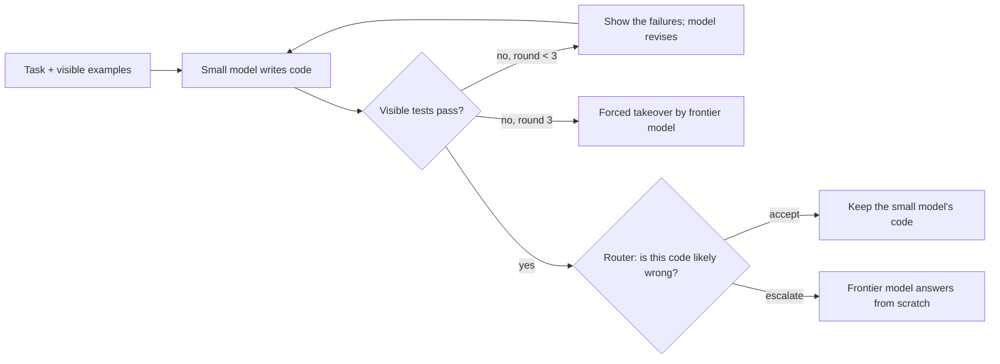

# System 1 Powered SLM: full review guide

When should a small model ask for help? A small thinking model (Qwen3-1.7B) works through a write → test → revise loop on HumanEval+ and MBPP+. When its code passes the visible tests, a "System One" router predicts whether the code will still fail the hidden tests, and decides whether to accept the code or hand the task to a frontier model (Claude Sonnet 5.5). The router uses cheap loop features and zero-shot typed judgments from Jev (TypeSafe).

This guide is the full reference behind the [README](../README.md). It contains the question, the frozen protocol, every result with its status (confirmatory, descriptive or exploratory), the deviations, the limitations, and where each number comes from. **The study is complete; all numbers are final** (October 18, 2026).

For review, the files at this commit are authoritative: [docs/research-plan.md](research-plan.md) is the frozen plan (an export of the team's working document), and the dev-phase details are in [docs/findings.md](findings.md).

## Contents

0. [How the experiment works](#how-the-experiment-works) (start here)
1. [Glossary](#glossary) (abbreviations and terms)
2. [Findings in brief](#findings-in-brief)
3. [Status of each claim](#status-of-each-claim)
4. [Protocol](#protocol)
5. [Data](#data)
6. [Planned tests (Holm family)](#planned-tests-holm-family)
7. [Table 1](#table-1-failure-prediction-on-visible-pass-test-checkpoints)
8. [Each Jev answer alone](#each-jev-answer-alone-prespecified-audit)
9. [Operating points at the frozen thresholds](#operating-points-at-the-frozen-thresholds)
10. [Escalation replay](#escalation-replay-descriptive)
11. [Cross-benchmark transfer](#cross-benchmark-transfer-amendment-a11-descriptive)
12. [Exploratory analyses](#exploratory-analyses-after-the-planned-analysis)
13. [Reporting completeness](#reporting-completeness)
14. [Deviations and integrity](#deviations-and-integrity)
15. [Limitations](#limitations)
16. [Closest related work](#closest-related-work)
17. [Where each number comes from](#where-each-number-comes-from)
18. [Questions for the reviewer](#questions-for-the-reviewer)

## How the experiment works

This section explains the setup in plain terms, step by step. Exact definitions are in [Protocol](#protocol); words such as AUROC are in the [Glossary](#glossary).

### The problem

A small, cheap model writes code for a programming task and checks it with the few example tests it is given. When those examples pass, it stops. But code can pass the examples and still be wrong: in our test data, **19.2% of the code that passed its visible examples failed the full hidden test suite**. A rule that looks only at the visible tests cannot catch these cases, because by definition they all passed. The question is whether a cheap "router" can spot them, so that only those tasks are sent to an expensive frontier model.

### Step by step

1. **Tasks.** 542 Python tasks from two standard benchmarks: 164 from HumanEval+ and 378 from MBPP+. Each task has a short description, a few visible examples, and a much larger hidden test suite (EvalPlus). Before anything else, the tasks were split once at random into **dev** (40%, 217 tasks) and **test** (60%, 325 tasks). Dev tasks were used to build and tune everything. Test tasks were used only once, at the end.
2. **The small model works on each task.** Qwen3-1.7B, a 1.7-billion-parameter model that "thinks" (writes out its reasoning) before it answers, runs on a local RTX 3070 GPU. For each task it makes 5 independent attempts. In each attempt:
   - Round 1: it gets the task and the visible examples, thinks, and writes code.
   - The code runs on the visible examples in a locked-down sandbox.
   - If the examples pass, the attempt stops there. If not, the model gets its previous code and the failure messages (not its previous thinking) and tries again, for at most 3 rounds.
   - Each round is one **checkpoint**: one piece of code with its test results, its thinking, and loop information (for example "did the pass count go up?").
3. **Grading (the ground truth).** After all attempts were finished, every checkpoint's code was run on the full hidden test suite, in a separate grader with the model stopped. This gives each checkpoint a **label**: does this code actually fail? The model and the routers never saw these hidden results.
4. **The decision point.** Every attempt that passes its visible examples reaches one decision: accept the code, or escalate to the frontier model. The test data has 1,457 such visible-pass checkpoints; 280 of them (19.2%) are actually wrong. These 1,457 checkpoints are the population of the main test.
5. **The signals that a router can use** at that decision:
   - **Cheap features** (free to compute): the visible test results, the round number, code length, thinking length, whether the thinking hit its length limit, repeat signals, and the model's own confidence in the words it wrote (logprobs).
   - **Jev** (a commercial judge model; about $0.0001 per question set): we send it the task, the code and the test output, and ask fixed yes/no questions, for example *"Is the current code likely to fail on valid inputs beyond the visible tests?"* It returns a probability for "yes". Each checkpoint gets two Jev requests: one **without** the model's thinking (3 questions about the code) and one **with** the thinking (the same 3 plus 6 questions about the reasoning, for example *"Is the model working on the assigned problem as it is stated?"*). This lets us measure whether reading the reasoning helps.
   - **Comparison judges:** Pinocchio-0.8B (an open model trained to estimate whether an answer is correct) and a confidence score from the small model's logprobs.
6. **Building the routers on dev data.** A router turns the signals into one failure score. The main routers are logistic regressions (a weighted sum of the signals turned into a probability): one with the cheap features only, one with cheap features + Jev's code answers, and one with cheap features + Jev's code and thinking answers. Their weights, and the score thresholds for escalation, were learned on the dev tasks only.
7. **Freeze.** Before the small model saw any test task, the whole protocol was fixed in a git commit (tag `protocol-freeze-v1`): the routers and their weights, the thresholds, the two planned statistical tests, and the analysis rules. After that, nothing was tuned. Two later changes are recorded as amendments, both made before any test code was graded (one of them removes one task with a broken hidden test).
8. **Run the test tasks once.** The small model made 1,625 attempts on the 325 test tasks; Jev answered all 4,196 requests; Pinocchio scored every checkpoint; the hidden grader labeled every checkpoint except those of the one excluded task. The frontier model (Claude Sonnet 5.5) answered each of the 324 kept test tasks 3 times from scratch, and those answers were graded too.
9. **Measurement 1: does the router rank wrong code higher?** On the 1,457 visible-pass test checkpoints, each router's score is compared with the labels using **AUROC**: the chance that a randomly chosen wrong checkpoint gets a higher score than a randomly chosen correct one (0.5 = guessing, 1.0 = perfect). The two planned tests, fixed before the test data existed, are:
   - **Primary:** does adding Jev's answers to the cheap router raise its AUROC?
   - **Secondary:** does adding Jev's answers about the *thinking* help beyond its answers about the *code*?

   Both use a paired bootstrap over whole tasks (resampling tasks 19,999 times to measure uncertainty) and the Holm correction for running two tests.
10. **Measurement 2: does it pay off when we actually escalate?** A replay simulates each routing policy on the logged test runs, with no new model calls: at every visible pass, the policy accepts or escalates according to its score and frozen threshold. If it escalates, the outcome is the frontier model's graded answer for that task (the mean over its 3 answers). Each policy is compared with:
    - **always-small:** never escalate;
    - **forced-only:** escalate only after 3 failed rounds;
    - **always-frontier:** the frontier model answers every task;
    - **random escalation** at the same rate, which shows whether the router's ranking adds value;
    - **an oracle** that knows the answers, as an upper bound.

    The replay reports the final pass rate, the frontier calls, and the cost in two views: electricity for the local GPU, and a hypothetical cloud GPU price.
11. **Afterwards: descriptive and exploratory analyses.** This guide also reports planned descriptive results (each Jev answer alone, results by benchmark, transfer between the benchmarks) and, clearly labeled, analyses chosen after seeing the results.

### One attempt, as an example

| Round | What happens | Visible tests | What we record |
| --- | --- | --- | --- |
| 1 | The model reads the task, thinks for 2,100 tokens, writes code | 1 of 2 examples pass | checkpoint r1: code, test output, thinking, cheap features; label from the hidden grader |
| 2 | The model gets its code and the failure message, thinks again, writes new code | 2 of 2 pass, so the loop stops | checkpoint r2: same records; this is the **decision point** |
| — | Router: cheap features + Jev's answers give a failure score of 0.71; the threshold for a 25% budget is 0.66, so it **escalates** | — | the frontier model's 3 graded answers give the outcome for this attempt |

If the hidden tests show that the round-2 code was in fact wrong and the frontier answers pass, this escalation is a **rescue**. If the code was right and a frontier answer fails, it is a **harm**. (The numbers in this example are illustrative, not a specific logged attempt.)

## Glossary

### Abbreviations

| Abbreviation | Stands for | Meaning here |
| --- | --- | --- |
| AUROC | Area Under the Receiver Operating Characteristic curve | How well a score ranks failing code above passing code. Take one failing and one passing checkpoint at random: AUROC is the chance that the failing one gets the higher score. 0.5 = coin flip, 1.0 = perfect. |
| ΔAUROC | difference in AUROC | AUROC of one router minus AUROC of another, on the same rows. Positive = the first router ranks better. |
| AUPRC | Area Under the Precision–Recall Curve | Another ranking measure that focuses on the failing rows. Here it is computed as "average precision". A random score gets the failure rate (0.192). |
| ROC | Receiver Operating Characteristic | The curve of true-positive rate against false-positive rate over all thresholds; AUROC is the area under it. |
| FPR | False-Positive Rate | Share of passing code that a router escalates anyway (an unnecessary frontier call). |
| FNR | False-Negative Rate | Share of failing code that a router accepts (a missed failure). "FNR at 5% FPR" = the miss rate when at most 5% of passing code is escalated. |
| CI | Confidence Interval | The range of plausible values for a number. "95% CI +0.020 to +0.068" means the data are consistent with a true value anywhere in that range. |
| LR | Logistic Regression | A simple statistical model that combines many input numbers (features) into one probability of failure, with one weight per feature. |
| L2, C = 1 | L2 regularization with strength setting C = 1 | A standard, fixed setting that keeps the LR weights small, so the model does not over-fit a small training set. It was not tuned. |
| OOF | Out-Of-Fold | A prediction for a row made by a model that was trained without that row's task. It gives honest scores on the training data itself. |
| ECE | Expected Calibration Error | How far predicted probabilities are from the observed failure rates. Not reported. |
| LLM | Large Language Model | A model such as GPT or Claude. |
| SLM | Small Language Model | Here Qwen3-1.7B (1.7 billion parameters). |
| API | Application Programming Interface | The web service that a program calls (Jev, OpenRouter). |
| GPU / CPU | Graphics / Central Processing Unit | The graphics card (RTX 3070) runs the small model; the CPU runs Pinocchio and the sandbox. |
| RTX 3070, A10G | two NVIDIA GPU models | The RTX 3070 is the local card used; the A10G is a cloud card used only to put a price on GPU time. |
| UTC | Coordinated Universal Time | The time zone of all times in this guide. |
| Wh, kWh | watt-hour, kilowatt-hour | Units of electrical energy (1 kWh = 1,000 Wh). |
| GiB | gibibyte | 1,073,741,824 bytes (memory size). |
| pp | percentage points | The difference between two percentages: 85% vs 83% is +2 pp. |
| HE+ / HumanEval+, MBPP+ | HumanEval Plus, Mostly Basic Python Problems Plus | Two standard Python coding benchmarks; the "+" versions (EvalPlus) add many more hidden tests per task. |
| VP | Visible Pass | A checkpoint whose code passes the visible tests. |
| q_VP | the escalation budget | The share of visible-pass checkpoints that a policy sends to the frontier model (10%, 25% or 50%). |
| NA | Not Applicable | A Jev question that cannot apply to a checkpoint (for example a question about the previous round, in round 1). |
| A1, A2 | Amendments 1 and 2 | Recorded changes to the plan after the freeze; see [Deviations and integrity](#deviations-and-integrity). |
| SWE-bench, APPS, CodeContests, LiveCodeBench | other coding benchmarks | Mentioned in related work. |

### Terms

| Term | Meaning here |
| --- | --- |
| Small model / frontier model | Qwen3-1.7B, which does the work; Claude Sonnet 5.5, a much larger model that is called only when the router escalates. |
| Checkpoint | One round of one attempt: the code the small model wrote in that round, with its test results. |
| Attempt, round | Each task gets 5 independent attempts. In each attempt the model gets up to 3 rounds to write and fix its code. |
| Visible tests / hidden tests | Visible tests are the examples shown to the model; it can run them. The hidden (grading) tests are the full EvalPlus suite, used only to make the label. |
| Label | Whether a checkpoint's code fails the hidden tests (1 = fails). |
| Router | The part that decides, at a visible pass, whether to accept the code or escalate to the frontier model. It does this by comparing a failure score with a threshold. |
| Escalate, takeover | Send the task to the frontier model, which answers from scratch. |
| Forced takeover | An attempt that never passed the visible tests after 3 rounds; every policy (except always-small) sends it to the frontier model. |
| Jev | A commercial "System One" model from TypeSafe that answers typed questions (here yes/no) with probabilities, without writing text. |
| Typed question, zero-shot | A question with fixed answer options and written true/false criteria; zero-shot = no examples and no training on our data. |
| History call / trace call | The two Jev requests per checkpoint: without and with the model's thinking. |
| Thinking, trace | The text the small model writes to reason before its answer. |
| Cap hit | The thinking reached the 8,192-token limit and was stopped. |
| Token | A piece of text (about 3/4 of an English word) that language models read and write. |
| Logprob | The log of the probability that the model gave to the token it wrote; low values mean the model was unsure. |
| Cheap features | Numbers that cost nothing extra: test results, code length, thinking length, logprob summaries, repeat signals. |
| Strong4 | Four Jev answers selected on dev data; "strong4 mean" is their plain average. |
| Pinocchio-0.8B | An open 0.8-billion-parameter model trained to estimate whether an answer is correct; a comparison judge. |
| Dev / test split | Dev tasks (40%) were used to build and freeze everything; test tasks (60%) were used only once, for the final results. |
| Freeze, tag | Fixing the protocol in a git commit before the test data exist; the tag `protocol-freeze-v1` marks that commit. |
| Confirmatory / descriptive / exploratory | See [Status of each claim](#status-of-each-claim): a test planned and frozen in advance / a planned measurement / an analysis chosen after seeing the results. |
| Bootstrap | Estimating uncertainty by re-sampling the data many times (here whole tasks, 19,999 times) and recomputing the number each time. |
| p-value | The probability of a difference at least this large if there were truly no difference. Small = unlikely to be luck. |
| Holm correction | An adjustment of p-values when more than one test is run, so that the chance of any false positive stays at 5% (α = 0.05). |
| Pooled vs task-weighted | Pooled counts every checkpoint once; task-weighted gives every task the same total weight. |
| Threshold, quantile | A router escalates when its score is above the threshold; each threshold was set on dev data so that a given share (the quantile) of dev scores is above it. |
| Top-k view | Escalate exactly the k highest-scoring test checkpoints, so all routers use the same budget. |
| Random comparator | Escalating the same share of checkpoints at random; the gain over it shows the value of the router's ranking. |
| Oracle | An impossible ideal policy that knows the hidden outcomes; an upper bound. |
| Rescue / harm | An escalation that turns failing code into a passing answer / passing code into a failing answer. |
| Replay | Simulating every policy offline from the logged runs and the stored frontier answers, with no new model calls. |
| Transfer | Training a router on one benchmark and testing it on the other. |
| Sampling (temperature, top-p, top-k) | Settings that control how randomly the small model picks each next token. |
| vLLM | The software that runs the small model on the GPU. |
| EvalPlus | The test framework that holds the hidden tests and grades the code. |
| Sandbox | An isolated container without network access where model-written code runs. |
| atol | Absolute tolerance: the largest allowed numeric error when comparing a result. |

## Findings in brief

1. **Primary test (confirmatory): Jev's answers add signal to a strong cheap baseline.** On 1,457 visible-pass test checkpoints, the frozen cheap-feature LR reaches AUROC 0.689. With Jev's answers, it reaches 0.732: ΔAUROC +0.044 (unadjusted 95% CI +0.020 to +0.068), Holm p = 0.0006. Descriptively, most of the gain comes from Jev's three code questions (cheap + code: 0.744).
2. **Trace contrast (confirmatory): adding Jev's answers about the thinking reduced AUROC.** Adding the five applicable thinking answers to cheap + code changed AUROC by −0.012 (−0.021 to −0.004), Holm p = 0.010, in the frozen LR pipeline. This does not establish that the reasoning has no useful information: the two always-applicable thinking answers alone reach 0.72–0.77 (the round-2–3 ones 0.66–0.76 on 111 rows), but they also see the code. Exploratory checks ([section 12](#exploratory-analyses-after-the-planned-analysis)) did not identify an explanation.
3. **Exploratory: the raw `code_likely_fails` answer has the highest AUROC of all evaluated scores (0.826).** This is the maximum of a prespecified per-answer audit, selected after seeing the test results, so it is an exploratory result that needs confirmation on new tasks. The frozen LRs that contain this answer score lower (0.731–0.744); the small dev set (116 failures) is one possible reason, not an established one.
4. **Replay (descriptive): routing helps a little.** At the frozen thresholds, the LR and Jev routers beat random escalation at the same realized rate by +1.2 to +3.9 points of final hidden pass; Pinocchio by +0.6 to +1.5 (two intervals at the 10% budget include zero). At about half the frontier calls, the primary Jev LR reaches 88.3% vs 90.3% for always-frontier.
5. **Cost (descriptive):** one frontier takeover costs about $0.002. Under electricity-only marginal cost, the displayed small-model policies (budgets up to 50%) stay below always-frontier. Under a hypothetical cloud normalization (RTX 3070 runtime priced at an A10G hourly rate), every displayed small-model policy costs more than always-frontier.
6. **Transfer (descriptive, Amendment A1):** fit on HumanEval+ dev rows, Jev adds +0.115 AUROC on MBPP+ test rows; fit on MBPP+ dev rows, +0.015. The HumanEval+ target (+0.109 vs +0.004) is below the 30/30 reporting rule and is sparse evidence. The training sets differ in size, and this tests the transfer of LR weights, not of question selection (the questions were selected on both benchmarks' dev data).

## Status of each claim

| Claim | Status |
| --- | --- |
| Primary ΔAUROC; trace contrast | **Confirmatory**: frozen before test generation (tag `protocol-freeze-v1`), Holm over the two. The primary population was changed once after the freeze (Amendment A2, one task excluded) before any generated test candidate received a hidden label. |
| Table 1, by benchmark, per-answer audit, same-question contrast, operating points | Descriptive, prespecified |
| Strong4 sensitivities (cheap + strong4, strong4 mean) | Descriptive; selected on dev data after the predict-v2 freeze, frozen before any test trajectory existed |
| Escalation replay | Descriptive, prespecified (budgets, thresholds, ties, fallback and the visible-fail rule frozen before test generation) |
| Cross-benchmark transfer | Descriptive. Analysis specified in Amendment A1 before any test label; the transfer models were fit on dev rows and committed after the primary analysis but before they scored any test row |
| Raw `code_likely_fails` vs other scores; diagnostics of the trace contrast | **Exploratory**: chosen after seeing test results |

### Timeline (UTC; commits on `main`)

| When | Commit | Event |
| --- | --- | --- |
| Oct 16 07:46 | `70f71ed` | 40/60 dev/test split frozen ([configs/split_v1.json](../configs/split_v1.json)) |
| Oct 17 00:03 | `2e57fdc` | 8K thinking cap frozen after the dev pilot |
| Oct 17 01:22 | `af8477a` | Predictor schema frozen (predict-v2) |
| Oct 17 05:03 | `1b79858` | Strong4 sensitivities, Holm test procedure and scope cuts frozen |
| Oct 17 06:46 | `24e9e01` | Routers v2 frozen (final models, thresholds, Pinocchio) |
| Oct 17 07:26 | `d749eea` | Commit tagged `protocol-freeze-v1` (commit time; the runner refuses test generation without the tag, `dc30308`) |
| Oct 17 08:05 | — | Test generation starts (run fingerprint commit `7da3063`) |
| Oct 17 16:32 | `631ce5d` | Amendment A1 (transfer analysis, optional 32K arm) |
| Oct 17 20:11 | — | First grading session stops at the reference calibration on HumanEval/32; no candidate was graded |
| Oct 17 20:51 | `c71b373` | Amendment A2 (HumanEval/32 excluded) |
| Oct 17 20:51 | — | Candidate grading session `20261017T205152` |
| Oct 18 about 00:10 | — | Test analysis run with `scripts/test_analysis.py` (written after the freeze; committed at 03:40 in `5e2e68e`) |
| Oct 18 03:41 | `d1582a5` | Transfer models fit on dev rows and frozen |
| Oct 18 04:07 | `1fa6d58` | Descriptive additions to the test analysis; the Holm results did not change |

## Protocol

### Generation and labels

| Item | Value |
| --- | --- |
| Small model | `Qwen/Qwen3-1.7B` at revision `70d244cc`, thinking mode, vLLM on an RTX 3070 |
| Frontier model | `anthropic/claude-sonnet-5.5-20260928` through OpenRouter, provider pinned to Anthropic with no fallbacks, reasoning effort low, max 8,000 output tokens, provider-default temperature, prompt = the small model's round-1 message ([src/system1/frontier/client.py](../src/system1/frontier/client.py)); 3 independent calls per task |
| Sampling | temperature 0.6, top-p 0.95, top-k 20; thinking cap 8,192 tokens, answer limit 2,048 tokens, context 16,384 tokens; per-request seeds fixed, but vLLM batching makes runs not bit-reproducible |
| Loop | round 1 prompt = instruction + task + visible tests. The code runs on the visible tests in a network-less sandbox. If they pass, or after round 3, the attempt ends; else the next round gets the task, the previous code and its visible-test output (never the previous thinking). 5 attempts per task |
| Split | fixed 40/60 dev/test split by task, stratified by benchmark, seed 20261016 |
| Dev sampling | attempt 0 on all 217 dev tasks; attempts 1–4 on a frozen, seeded one-third subsample of each benchmark's dev tasks (72 tasks) |
| Checkpoint | one round of one attempt |
| Label | the same code fails the EvalPlus 0.3.1 grading suite (base + plus inputs) |
| Primary population | test checkpoints whose code passes the visible tests. Rules that use only visible-test results cannot separate these rows. |

**Visible tests** ([src/system1/loop/tasks.py](../src/system1/loop/tasks.py), frozen in [configs/visible_tests_v2.json](../configs/visible_tests_v2.json)) are exactly the examples the model sees. MBPP+: the one `assert` line in the task prompt. HumanEval+: the `>>>` docstring examples; for a task without a usable example, the first three original HumanEval inputs with their ground-truth outputs, shown as a test list. **The grading suite is the full EvalPlus base + plus suite, so it can contain the visible examples** (the HumanEval fallback inputs are base inputs). What the model and Jev never see are the other grading inputs and all grading outcomes.

Every reference solution passes its own visible tests, except in two HumanEval tasks whose docstring examples are wrong (HumanEval/47, /116). Those examples are kept, because they are what the model sees, and flagged. A correct solution fails them, which explains 21 of the 22 visible-fail checkpoints that pass the grading suite (HumanEval/116: 15, /47: 6). The last one (Mbpp/104, round 1) fails the prompt's `assert` but passes every grading input; we did not examine it further. Visible-fail checkpoints are not in the primary population.

### What Jev reads and answers

Each checkpoint gets two Jev calls on one shared base state: the task, the current code, the visible-test output and six loop-telemetry numbers (visible pass fraction, pass-count change, similarity to the previous code, same error, same failing tests, return to earlier code). Code: [src/system1/features/evidence.py](../src/system1/features/evidence.py).

- **History call:** base + the previous code and its test output (rounds 2–3 only). It asks the 3 code questions.
- **Trace call:** the history call's evidence + the current round's thinking (head and tail kept under the budget; no 8K trace needed a cut). It asks the same 3 code questions plus the 6 thinking questions.
- Every request stays under 56,000 bytes. Jev returns P(true) with two decimals. All 4,196 test calls succeeded on the first try; the API reported `jev-1.13.0` throughout.

Questions ([configs/rubric_v2.yaml](../configs/rubric_v2.yaml), frozen before the pilot, with explicit true and false criteria). "Bad" is the answer that means trouble:

| Question | Call | Applies | Bad answer |
| --- | --- | --- | --- |
| `code_likely_fails`: Is the current code likely to fail on valid inputs beyond the visible tests? | both | always | true |
| `special_cases_visible_tests`: Does the code special-case the visible test inputs instead of solving the task? | both | always | true |
| `repeats_previous_code`: Is the current code essentially the same as the previous attempt? | both | rounds 2–3 | true |
| `on_task`: Is the model working on the assigned problem as it is stated? | trace | always | false |
| `repeating_failed_fix`: Is the model repeating a fix that already failed? | trace | rounds 2–3 | true |
| `approach_change_without_evidence`: Does the model change its approach without new evidence? | trace | rounds 2–3 | true |
| `unsupported_claim`: Does the thinking make a claim about the code, the tests or an API that the evidence does not support? | trace | always | true |
| `stated_fix_matches_change`: Does the code change match the fix that the thinking says it makes? | trace | rounds 2–3 | false |
| `clear_next_step`: Does the model have a clear next step? | trace | never at a visible pass | false |

(The comment above `TRUE_IS_GOOD` in `predict.py` omits `clear_next_step`; that question never applies at a visible pass, so no reported number uses it.)

### Predictors and scores

Code: [src/system1/eval/predict.py](../src/system1/eval/predict.py) (predict-v2).

- **LR pipeline:** standard scaling, then L2 logistic regression with C = 1, refit once on all 470 dev visible-pass rows (205 tasks; 116 hidden fails from 49 of those tasks). No tuning. The columns come from a fixed schema. Structural missing values (for example history features in round 1) are zero-filled with shared `first_round` and `trace_missing` indicators; other missing values get their own indicator.
- **Cheap features:**
  - round, visible pass fraction, visible not-run count, code lines, "wait"-marker count, log thinking tokens;
  - logprob summaries: thinking mean logprob, tail confidence, bottom-10% group confidence, answer mean logprob;
  - visible pass, cap hit, thinking closed, loop flag (an 8-word n-gram repeated at least 6 times), code missing;
  - the five history numbers (pass-count change, similarity, same error, same failing tests, return to earlier code);
  - error type (assertion, timeout, load, other).
- **Cheap + code:** + the 3 code answers from the history call.
- **Cheap + code + thinking (primary Jev set):** + the 5 thinking answers that can apply at a visible pass, from the trace call. The code answers still come from the history call.
- **Strong4 mean** (no fitting): (p(`code_likely_fails`) + p(`special_cases_visible_tests`) + (1 − p(`on_task`)) + p(`unsupported_claim`)) / 4, code answers from the history call. A structurally unavailable answer counts as 0.5 and the denominator stays 4; a failed call would leave the row out (none failed). It is a heuristic score, not a calibrated probability. **Cheap + strong4** is the LR with the same four answers.
- **Pinocchio-0.8B** ([arXiv:2609.24881](https://arxiv.org/abs/2609.24881)): base `Qwen/Qwen3.5-0.8B` with adapter `KevinDavidHayes/pinocchio-0.8b`, both at pinned revisions ([configs/pinocchio_setup_v1.json](../configs/pinocchio_setup_v1.json)), package `pinocchio-uq==0.1.1` defaults ("combined" prompt, question cut at 1,500 and answer at 800 characters), CPU, float32. Score = 1 − p_correct. Input-v1 (primary, frozen first): the round-1 task message as the question and the answer text after the thinking as the answer. Input-v2 (sensitivity, frozen before it was scored): the executed code as the answer, because the cut hid the graded code in about 30 of 470 dev answers.
- **Logprob tail confidence** (`predict.logprob_comparator`): the DeepConf-style confidence of the last ≤ 1,024 thinking tokens (per token, minus the mean of its top-5 logprobs; then the mean over those tokens), negated so that higher = more likely to fail; a missing value would get the score 1.0 (none was missing).

### Statistics

- **Confirmatory test** (`predict.bootstrap_test`, `predict.holm`): ΔAUROC on the same rows; two-sided paired bootstrap centered on the null (Hall and Wilson), 19,999 replicates, whole tasks resampled within benchmark with all their rows and both scores; p = (1 + #{|Δ* − Δ̂| ≥ |Δ̂|}) / (B + 1). Holm over the two tests (familywise α = 0.05). The 95% intervals are percentile intervals of Δ* and are **not** adjusted for multiplicity.
- **Descriptive intervals** (Table 1, same-question, audit): percentile intervals from 2,000 whole-task bootstrap draws over fixed scores, not stratified.
- **Pooled AUROC** treats every checkpoint as one row. **Task-weighted AUROC** gives each row weight 1 / (the task's number of rows), so each task has the same total weight. **Within-task AUROC** is the mean, over the 47 tasks that have both outcomes among their visible-pass attempts, of the AUROC inside each task.
- **FNR at 5% FPR** is a descriptive ROC point: the most permissive observed threshold on the *test* scores with FPR ≤ 5% (escalate if s ≥ t, ties kept together). It is not a deployment threshold; the frozen dev thresholds are in [Operating points](#operating-points-at-the-frozen-thresholds).
- **Transfer intervals** are conditional on the fitted models (19,999 replicates; no replicate had to be dropped for having one class).

### Replay rules (frozen before test generation)

- **Decisions:** the loop accepts a visible pass at once, so an attempt has at most one optional decision: its visible-pass checkpoint. There a policy accepts or escalates. An attempt that never passes the visible tests ends after round 3 and is a forced takeover for every policy except always-small.
- **Takeover:** one frontier answer, from scratch, to the round-1 prompt, with no repair. There are 3 independent answers per task. The final outcome of an escalated attempt is the mean of its task's 3 graded answers, so the same 3 answers serve every attempt of that task.
- **Thresholds:** for budgets q_VP = 10/25/50% of visible-pass decisions, each threshold is the weighted quantile of the router's dev scores: task-grouped out-of-fold predictions for the LRs (mean over 20 fold splits), the directly computed scores for the strong4 mean and Pinocchio (no fitting). Each row has weight 1 / (sampled attempts of its task). Ties: escalate if s > t, or s = t and a frozen hash of the checkpoint id is below α. A missing Jev score falls back to the cheap LR (never needed).
- **Random comparator:** escalates a share of the decision checkpoints equal to the policy's realized rate, uniformly over all test decision checkpoints (pooled over benchmarks), in closed form: (1 − q) y + q z̄.
- **Oracle:** for each frontier replicate, it escalates a decision checkpoint exactly when that replicate's answer passes and the small model's code does not; forced takeovers stay.
- **Uncertainty:** whole tasks resampled within benchmark, with all their attempts, frontier replicates and scores.
- **Costs per attempt:**
  - *Electricity-only marginal cost:* measured GPU board energy at an assumed $0.15/kWh, plus API spend.
  - *Hypothetical cloud normalization:* the RTX 3070 runtime priced at the A10G on-demand rate of $1.006/h, plus API spend. It is not a measurement on an A10G.
  - The small model's share is its attempt's share of the run's generated tokens. The denominator includes the excluded task (1.3% of the run), so that share is not moved onto kept attempts.
  - Jev dollars use a third-party price ($0.042 per million input tokens), not confirmed billing.
  - Pinocchio's CPU time (about 2.0 s per decision) is reported but not priced.

## Data

| Run | What | Size |
| --- | --- | --- |
| `pilot-v1`, `pilot-v1b` (dev) | 217 dev tasks | 505 attempts, 621 checkpoints; 470 visible-pass rows from 205 tasks (116 hidden fails from 49 tasks) |
| `main-test-v1` (test) | 325 test tasks × 5 attempts | 1,625 attempts, 2,098 checkpoints |
| after Amendment A2 | HumanEval/32 excluded | 324 tasks, 1,620 attempts, 2,086 checkpoints, 1,457 visible-pass |
| `frontier-test-v1` | 324 tasks × 3 takeover answers | 972 answers: 878 pass, 94 fail |

Visible-pass test population: 1,457 checkpoints from 309 tasks; 280 hidden fails (19.2%) from 89 tasks. A task can contribute both outcomes.

| Subset | Rows | Hidden fails | Tasks with a fail | Tasks with a pass |
| --- | --- | --- | --- | --- |
| HumanEval+ | 450 | 51 | 18 | 86 |
| MBPP+ | 1,007 | 229 | 71 | 181 |
| Round 1 / 2 / 3 | 1,346 / 82 / 29 | 239 / 28 / 13 | — | — |

## Planned tests (Holm family)

| Test | Contrast | ΔAUROC | 95% CI (unadjusted) | p | Holm p |
| --- | --- | --- | --- | --- | --- |
| Primary | cheap + code + thinking − cheap | +0.044 | +0.020 to +0.068 | 0.0003 | **0.0006** |
| Secondary (trace contrast) | cheap + code + thinking − cheap + code | −0.012 | −0.021 to −0.004 | 0.0103 | **0.0103** |

## Table 1: failure prediction on visible-pass test checkpoints

| Router | Kind | AUROC (95% CI) | Task-weighted | AUPRC | FNR @ 5% FPR | Brier |
| --- | --- | --- | --- | --- | --- | --- |
| Cheap LR | baseline | 0.689 (0.629–0.746) | 0.701 | 0.366 | 0.786 | 0.156 |
| Cheap + code (Jev) | LR + Jev | 0.744 (0.687–0.799) | 0.755 | 0.474 | 0.725 | 0.138 |
| Cheap + code + thinking (Jev) | LR + Jev, primary | 0.732 (0.674–0.788) | 0.746 | 0.454 | 0.732 | 0.141 |
| Cheap + strong4 (Jev) | dev-selected sensitivity | 0.731 (0.673–0.787) | 0.743 | 0.455 | 0.743 | 0.142 |
| Strong4 mean (Jev, no LR) | dev-selected sensitivity | 0.816 (0.765–0.860) | 0.820 | 0.527 | 0.729 | — |
| Pinocchio-0.8B, input-v1 | standalone judge | 0.644 (0.581–0.708) | 0.664 | 0.302 | 0.907 | — |
| Pinocchio-0.8B, input-v2 | sensitivity | 0.613 (0.552–0.675) | 0.622 | 0.244 | 0.946 | — |
| Logprob tail confidence | standalone signal | 0.663 (0.598–0.721) | 0.679 | 0.320 | 0.846 | — |

AUPRC is average precision (prevalence 0.192). Brier only for LR probabilities. Descriptive Δ vs cheap: cheap + code +0.056 (+0.034 to +0.077); cheap + strong4 +0.043 (+0.019 to +0.065); strong4 mean +0.127 (+0.077 to +0.177); Pinocchio input-v1 −0.044 (−0.107 to +0.022); logprob −0.026 (−0.058 to +0.005).

| Benchmark | Cheap | + code | + code + thinking | Strong4 mean | Pinocchio | Logprob |
| --- | --- | --- | --- | --- | --- | --- |
| HumanEval+ (18 fail tasks) | 0.730 | 0.751 | 0.751 | 0.777 | 0.565 | 0.717 |
| MBPP+ (71 fail tasks) | 0.706 | 0.758 | 0.745 | 0.825 | 0.672 | 0.677 |

Within-task AUROC (47 tasks): cheap 0.504, cheap + code 0.571, cheap + code + thinking 0.546, strong4 mean 0.661. Results by round and by cap hit: `by_round` and `by_cap_hit` in [docs/results/test_analysis_main-test-v1.json](results/test_analysis_main-test-v1.json).

## Each Jev answer alone (prespecified audit)

Failure-oriented AUROC (the "bad" answer scores high) on the rows where the question applies. Results by benchmark and cap hit, with their support, are under `audit` in the result file.

| Question | Call | Rows | Fail tasks | AUROC |
| --- | --- | --- | --- | --- |
| `code_likely_fails` | history | 1,457 | 89 | 0.826 |
| `code_likely_fails` | trace | 1,457 | 89 | 0.807 |
| `special_cases_visible_tests` | history | 1,457 | 89 | 0.758 |
| `special_cases_visible_tests` | trace | 1,457 | 89 | 0.698 |
| `on_task` | trace | 1,457 | 89 | 0.765 |
| `unsupported_claim` | trace | 1,457 | 89 | 0.716 |
| `repeats_previous_code` | history / trace | 111 | 23 | 0.462 / 0.502 |
| `repeating_failed_fix` | trace | 111 | 23 | 0.696 |
| `approach_change_without_evidence` | trace | 111 | 23 | 0.763 |
| `stated_fix_matches_change` | trace | 111 | 23 | 0.663 |

**Same question with and without the thinking** (prespecified, descriptive; history call vs trace call on the same rows, 2,000-draw task bootstrap):

| Comparison | History call | Trace call | Δ (95% CI) |
| --- | --- | --- | --- |
| `code_likely_fails` | 0.826 | 0.807 | −0.019 (−0.056 to +0.017) |
| `special_cases_visible_tests` | 0.758 | 0.698 | −0.060 (−0.104 to −0.016) |
| `repeats_previous_code` (111 rows) | 0.462 | 0.502 | +0.041 (+0.005 to +0.080) |
| Cheap + code LR, frozen weights, code answers from each call | 0.744 | 0.731 | −0.013 (−0.025 to −0.002) |

## Operating points at the frozen thresholds

Deployment view on the visible-pass test rows: the share escalated, the realized FPR and FNR, and the hidden-fail rate among the accepted rows (19.2% if nothing is escalated).

| Router | Budget | Realized rate | FPR | FNR | Fail rate among accepted |
| --- | --- | --- | --- | --- | --- |
| Cheap LR | 10% / 25% / 50% | 0.084 / 0.213 / 0.460 | 0.054 / 0.168 / 0.408 | 0.786 / 0.596 / 0.321 | 0.165 / 0.146 / 0.114 |
| Cheap + code | 10% / 25% / 50% | 0.060 / 0.256 / 0.472 | 0.026 / 0.194 / 0.404 | 0.800 / 0.482 / 0.246 | 0.164 / 0.125 / 0.090 |
| Cheap + code + thinking | 10% / 25% / 50% | 0.065 / 0.240 / 0.477 | 0.031 / 0.180 / 0.412 | 0.789 / 0.511 / 0.250 | 0.162 / 0.129 / 0.092 |
| Cheap + strong4 | 10% / 25% / 50% | 0.065 / 0.244 / 0.458 | 0.031 / 0.184 / 0.393 | 0.793 / 0.504 / 0.268 | 0.163 / 0.128 / 0.095 |
| Strong4 mean | 10% / 25% / 50% | 0.074 / 0.253 / 0.491 | 0.037 / 0.168 / 0.406 | 0.768 / 0.393 / 0.154 | 0.159 / 0.101 / 0.058 |
| Pinocchio-0.8B | 10% / 25% / 50% | 0.106 / 0.246 / 0.450 | 0.090 / 0.204 / 0.407 | 0.825 / 0.579 / 0.368 | 0.177 / 0.147 / 0.129 |

## Escalation replay (descriptive)

Final hidden pass per attempt over all 1,620 attempts (mean over the 3 frontier replicates). Gains in percentage points with 95% CI.

**Deployment view (frozen thresholds; realized rates differ between routers).** Rescues and harms count only optional escalations at visible-pass checkpoints: a rescue escalates code that fails and the frontier answer passes; a harm escalates code that passes and the frontier answer fails. Forced takeovers after round 3 are the same for every policy and are not counted, so rescues − harms equals the gain over forced-only. The oracle has no harms by construction among optional escalations.

| Policy | Budget | Realized | Pass | Frontier calls / attempt | Rescues / harms per attempt (optional escalations only) | Gain vs random | Gain vs forced-only | $ electricity | $ cloud (hypothetical) |
| --- | --- | --- | --- | --- | --- | --- | --- | --- | --- |
| Always small | — | — | 0.730 | 0 | — | — | — | 0.00015 | 0.00634 |
| Forced-only (escalate after 3 failed rounds) | — | 0 | 0.807 | 0.101 | — | — | — | 0.00052 | 0.00671 |
| Always frontier | — | — | 0.903 | 1 | — | — | — | 0.00196 | 0.00196 |
| Oracle | — | 0.131 | 0.925 | 0.219 | 0.118 / 0 | — | — | 0.00078 | 0.00697 |
| Cheap LR | 25% | 0.213 | 0.849 | 0.293 | 0.050 / 0.008 | +2.2 (+0.8 to +3.5) | +4.2 (+2.4 to +6.3) | 0.00101 | 0.00720 |
| Cheap LR | 50% | 0.460 | 0.873 | 0.514 | 0.081 / 0.015 | +2.2 (+0.7 to +3.6) | +6.6 (+4.1 to +9.4) | 0.00146 | 0.00765 |
| Cheap + code | 25% | 0.256 | 0.858 | 0.331 | 0.062 / 0.011 | +2.7 (+1.2 to +4.2) | +5.1 (+3.0 to +7.4) | 0.00113 | 0.00732 |
| Cheap + code | 50% | 0.472 | 0.884 | 0.525 | 0.092 / 0.015 | +3.1 (+1.6 to +4.6) | +7.7 (+5.0 to +10.6) | 0.00150 | 0.00769 |
| Cheap + code + thinking | 25% | 0.240 | 0.856 | 0.316 | 0.059 / 0.010 | +2.6 (+1.1 to +4.2) | +4.9 (+2.9 to +7.2) | 0.00121 | 0.00740 |
| Cheap + code + thinking | 50% | 0.477 | 0.883 | 0.530 | 0.091 / 0.015 | +3.0 (+1.4 to +4.5) | +7.6 (+4.9 to +10.5) | 0.00162 | 0.00781 |
| Strong4 mean | 25% | 0.253 | 0.867 | 0.328 | 0.071 / 0.010 | +3.6 (+1.9 to +5.3) | +6.0 (+3.7 to +8.7) | 0.00121 | 0.00740 |
| Strong4 mean | 50% | 0.491 | 0.893 | 0.542 | 0.102 / 0.016 | +3.9 (+2.5 to +5.3) | +8.6 (+5.7 to +11.7) | 0.00161 | 0.00780 |
| Pinocchio-0.8B | 25% | 0.246 | 0.845 | 0.322 | 0.046 / 0.008 | +1.4 (+0.0 to +2.9) | +3.8 (+2.0 to +5.7) | 0.00099 | 0.00718 |
| Pinocchio-0.8B | 50% | 0.450 | 0.865 | 0.506 | 0.070 / 0.012 | +1.5 (+0.0 to +2.9) | +5.8 (+3.5 to +8.4) | 0.00134 | 0.00753 |

**Ranking view at identical budgets (label-free top-k on the test scores; a batch analysis):**

| Router | Pass at 10% / 25% / 50% | Gain vs random at 10% / 25% / 50% |
| --- | --- | --- |
| Cheap LR | 0.833 / 0.849 / 0.877 | +1.6 / +1.8 / +2.2 |
| Cheap + code | 0.835 / 0.858 / 0.884 | +1.8 / +2.7 / +2.9 |
| Cheap + code + thinking | 0.835 / 0.858 / 0.885 | +1.8 / +2.7 / +3.0 |
| Strong4 mean | 0.836 / 0.867 / 0.894 | +1.9 / +3.6 / +3.9 |
| Pinocchio-0.8B | 0.823 / 0.844 / 0.866 | +0.6 / +1.3 / +1.1 |

At identical budgets, the primary Jev LR is 0.2 to 0.9 points above the cheap LR. The 10% rows, all intervals, the per-benchmark results and the cost components are in [docs/results/replay_main-test-v1_final_routers-v2.json](results/replay_main-test-v1_final_routers-v2.json). Example cost split (primary Jev LR, 50%, per attempt): small model $0.00015 (electricity) or $0.00634 (cloud), frontier $0.00132, Jev $0.00015.

## Cross-benchmark transfer (Amendment A1.1, descriptive)

Same target rows. "Source fit" is the LR fit on the other benchmark's dev rows; "target fit" is the LR fit on the target's own dev rows ([configs/routers_transfer_v1.json](../configs/routers_transfer_v1.json)). Gap = source fit − target fit. Reporting rule (A1): a discrimination statement needs at least 30 tasks with a visible-pass fail and 30 with a visible-pass pass.

| Direction | Feature set | Source fit | Target fit | Gap (95% CI) |
| --- | --- | --- | --- | --- |
| HumanEval+ → MBPP+ (71 fail tasks, 181 pass tasks; meets the rule) | cheap | 0.677 | 0.709 | −0.032 (−0.068 to +0.005) |
| | cheap + code | 0.784 | 0.740 | +0.043 (−0.006 to +0.093) |
| | cheap + code + thinking | 0.793 | 0.724 | +0.069 (+0.016 to +0.122) |
| | cheap + strong4 | 0.793 | 0.719 | +0.074 (+0.022 to +0.126) |
| MBPP+ → HumanEval+ (18 fail tasks, 86 pass tasks; below the rule, sparse) | cheap | 0.738 | 0.717 | +0.021 (−0.037 to +0.084) |
| | cheap + code | 0.744 | 0.822 | −0.077 (−0.211 to +0.025) |
| | cheap + code + thinking | 0.742 | 0.826 | −0.084 (−0.224 to +0.029) |
| | cheap + strong4 | 0.742 | 0.824 | −0.082 (−0.221 to +0.028) |

| Jev increment (cheap + code + thinking − cheap) | Fit on HumanEval+ dev | Fit on MBPP+ dev |
| --- | --- | --- |
| Target MBPP+ | +0.115 (+0.067 to +0.165) | +0.015 (−0.011 to +0.040) |
| Target HumanEval+ | +0.109 (+0.019 to +0.218) | +0.004 (−0.018 to +0.029) |

Training sets: HumanEval+ dev 147 rows from 66 tasks (41 fails from 19 tasks); MBPP+ dev 323 rows from 139 tasks (75 fails from 30 tasks). The gap compares training regimes; it is not a pure estimate of domain shift. Strong4 mean as a fixed reference: 0.825 (MBPP+), 0.777 (HumanEval+).

## Exploratory analyses (after the planned analysis)

These were chosen after seeing the test results. They are descriptive, not tests.

**Raw Jev answers vs the other scores** (paired bootstrap as in the Holm family; [scripts/analysis/nonlr_compare.py](../scripts/analysis/nonlr_compare.py)):

| Comparison | ΔAUROC (95% CI) |
| --- | --- |
| `code_likely_fails` − Pinocchio-0.8B | +0.182 (+0.109 to +0.250) |
| `code_likely_fails` − logprob tail confidence | +0.163 (+0.100 to +0.226) |
| `code_likely_fails` − cheap LR | +0.137 (+0.078 to +0.195) |
| Strong4 mean − Pinocchio-0.8B | +0.172 (+0.106 to +0.236) |
| Strong4 mean − logprob tail confidence | +0.153 (+0.101 to +0.206) |
| Strong4 mean − cheap LR | +0.127 (+0.078 to +0.177) |

**Same-question contrast by subset** ([scripts/analysis/trace_diagnostics.py](../scripts/analysis/trace_diagnostics.py)). These diagnostics concern the code answers of the trace call. The confirmatory trace contrast does not use those answers; it adds the thinking answers to the history-call code answers. So they describe the same-question comparison, not the −0.012.

| Subset | Rows | Fails | `code_likely_fails`: history → trace | `special_cases_visible_tests`: history → trace |
| --- | --- | --- | --- | --- |
| Cap-hit traces | 60 | 17 tasks | 0.853 → 0.812 | 0.749 → 0.797 |
| Loop flag set | 410 | 129 rows | 0.787 → 0.783 | 0.740 → 0.735 |
| Loop flag not set | 1,047 | 151 rows | 0.827 → 0.787 | 0.741 → 0.632 |
| Shortest third of traces | 486 | 37 rows | 0.843 → 0.787 | 0.691 → 0.600 |
| Longest third of traces | 486 | 162 rows | 0.807 → 0.785 | 0.710 → 0.702 |

- The changes are not concentrated in cap-hit, looping or long traces. This does not exclude an effect of trace quality or length.
- `special_cases_visible_tests` is almost always near 0 (mean P = 0.03) at two-decimal resolution. With the thinking, 74% of rows share one value (58% without), so fewer rows are separated. That is consistent with its lower AUROC; it is not shown to be the cause.
- `code_likely_fails`: with the thinking, Jev gives lower failure probabilities to failing code (mean 0.401 → 0.357) and to passing code (0.211 → 0.184).
- The two calls also differ in the number of questions asked (9 vs 3).
- Pipeline checks: every Jev score matches a request rebuilt from the stored trajectory; the largest request is 41,855 bytes (budget 56,000); no visible-pass checkpoint has empty thinking.

## Reporting completeness

| Prespecified item (plan) | Where |
| --- | --- |
| Primary and secondary tests | [Planned tests](#planned-tests-holm-family) |
| Table 1: AUROC, CI, AUPRC, FNR @ 5% FPR, Brier | [Table 1](#table-1-failure-prediction-on-visible-pass-test-checkpoints) |
| FNR at 1% and 10% FPR (exploratory) | `table1.<router>.fnr_at_fpr` in the result file |
| Split by benchmark; by round; by cap hit | Table 1 section; `by_round`, `by_cap_hit` in the result file |
| Within-task AUROC | Table 1 section |
| Per-answer audit, by benchmark and cap hit | [Each Jev answer alone](#each-jev-answer-alone-prespecified-audit); `audit.*.cells` in the result file |
| Same-question contrast (pooled and task-weighted) | same section; task-weighted under `same_question` in the result file |
| Realized FPR / FNR, capture and residual fail rate at the frozen thresholds | [Operating points](#operating-points-at-the-frozen-thresholds) |
| Replay: gain vs random and vs forced-only, rescues, harms, calls, costs, top-k view | [Replay](#escalation-replay-descriptive); replay result file |
| Transfer (A1.1) | [Transfer](#cross-benchmark-transfer-amendment-a11-descriptive) |
| Excluded task's share of run cost | 1.3% ([Replay rules](#replay-rules-frozen-before-test-generation)) |
| **Not reported:** AUROC on visible-fail checkpoints; ECE; break-even escalation rate; router overhead as a share of cost; frontier tokens per task; per-policy GPU seconds | not computed |
| **Not run:** drift labels, fine-tuned router, blind resampling, LLM-judge control (cut before the test phase); optional A1.2 32K arm | — |

## Deviations and integrity

- **Amendment A2 (HumanEval/32 excluded).** In EvalPlus 0.3.1, the `find_zero` special oracle ends with `continue`, which skips the bookkeeping of a passed input, so no solution can pass. The reference solution also fails 7 of 788 plus inputs at atol 1e-4. The grader's reference calibration stopped on this task before any candidate was graded; the task was then excluded from every test analysis ([configs/grading_exclusions_v1.json](../configs/grading_exclusions_v1.json)). Removed: 5 attempts, 12 checkpoints, 4 visible-pass checkpoints. Not chosen: repairing the oracle (a grader change after the freeze).
- **Hidden grading:** every session was a protocol session (vLLM stopped, clean git tree), with calibration of every reference solution and a 1 GiB memory canary. Each code was graded twice, with a third grade on disagreement: 0 disagreements and 0 invalid labels in the main grading.
- **Cost reconstruction:** the first session of the main test run (315 attempts) was killed before it wrote its time and energy. Both were rebuilt from its 3,043 power samples with the runner's own integration, after the method reproduced the stored value of the complete session (1,413.4 Wh). The last power sample (09:49:22) and the last ledger row (09:49:19) agree. The values are estimates of the sampled window; the original null values are kept in the run metadata.
- **Analysis code written after the freeze:** `scripts/test_analysis.py` and `scripts/transfer_analysis.py` implement the frozen rules. They fit and select nothing on test rows. Descriptive outputs were added after a code review; the confirmatory numbers did not change.

## Limitations

- **Scope:** one small generator with an 8K thinking cap, one frontier model, two older benchmarks that the models may have seen in training. External validity beyond HumanEval+ and MBPP+ is untested (LiveCodeBench was dropped because its newest problems predate Qwen3).
- **Small dev set:** the LRs were fit on 470 rows with 116 failures, so their weights are noisy.
- **HumanEval+:** only 18 tasks with a visible-pass failure.
- **Trace contrast:** the trace call differs from the history call in the thinking and in the number of questions, and its answers also see the code. The contrast cannot isolate "reading the thinking".
- **Jev:** a closed model behind an alias that cannot be pinned (the API reported `jev-1.13.0` throughout); two-decimal probabilities; price not confirmed.
- **Selection:** the highest single AUROC (0.826) was selected from the audit after seeing the results.
- **Costs:** the small-model cost includes one rebuilt session. Energy and time for hypothetical policies are allocations by tokens, not measurements. The cloud view is a normalization, not a measured cloud run.

## Closest related work

| Work | Relation |
| --- | --- |
| [CodeMonitorBench](https://arxiv.org/abs/2607.20852) | Same visible-pass / hidden-fail framing with LLM verifiers (7–8B: 0.60–0.67 AUROC; GLM-5.1: 0.83); no Jev; another population |
| [JevCoder](https://arxiv.org/abs/2610.19596) | Jev predicts whether one SWE-bench patch passes the tests (0.562–0.595 AUROC); no visible-pass filter |
| [JEV-as-a-Judge](https://arxiv.org/abs/2609.26550) | Pairwise judgments, including MBPP-Plus pairs (Jev 66.2% vs GPT-6 78.8%); confidence cascade |
| [Pinocchio](https://arxiv.org/abs/2609.24881) | Black-box correctness calibrator; Jev 0.666 vs 0.868 on general text answers |
| [Jev as an AI-control monitor](https://www.lesswrong.com/posts/d7pQicW8EhpPBDRqz/a-non-generative-model-as-a-trusted-monitor-for-ai-control) | Jev finds planted backdoors in test-passing APPS code (0.97–0.98 AUROC); no natural bugs |
| [Kev-0.8B code-verify-v2](https://huggingface.co/jtatman/kev-0.8b-code-verify-v2) | Open 0.8B typed judge trained on HumanEvalPack hidden-test labels (0.970 AUROC; no visible-pass filter; trained on HumanEval tasks) |

## Where each number comes from

The raw runs (trajectories, hidden labels, Jev and Pinocchio records, ledgers, power samples) are not in the repository (`results/runs/` is git-ignored); they are available from the authors on request. With them in `results/runs/`, the environment (`uv sync`, plus `uv sync --group pinocchio` for Pinocchio) and the sandbox image for grading, these commands recompute every number in this guide. Grading and scoring are already done; re-running them is not needed to recompute the analyses.

| Numbers | Command | Committed aggregate copy (the script writes to `results/`) |
| --- | --- | --- |
| Holm tests, Table 1, audit, same-question, operating points, by round / cap hit | `uv run python scripts/test_analysis.py --run-id main-test-v1` | [docs/results/test_analysis_main-test-v1.json](results/test_analysis_main-test-v1.json) |
| Replay (both views), costs | `uv run python scripts/replay.py --split test --run-id main-test-v1 --frontier-run frontier-test-v1 --scores final --routers v2` | [docs/results/replay_main-test-v1_final_routers-v2.json](results/replay_main-test-v1_final_routers-v2.json) |
| Transfer | `uv run python scripts/transfer_analysis.py --run-id main-test-v1` (models: `scripts/freeze_transfer.py`, already run) | [docs/results/transfer_main-test-v1.json](results/transfer_main-test-v1.json) |
| Exploratory: raw answers vs other scores | `uv run python scripts/analysis/nonlr_compare.py` | printed |
| Exploratory: same-question diagnostics | `uv run python scripts/analysis/trace_diagnostics.py` | printed |
| Cost reconstruction | `uv run python scripts/analysis/reconstruct_session_cost.py --run-id main-test-v1 --session 0` (check only; refuses to write again) | printed |
| Dev results, frozen models and thresholds | `scripts/resource_guide.py`, `scripts/freeze_routers.py` | `docs/results/`, `configs/routers_v2.json` |

Unit tests: `uv run pytest` (173 tests).

## Questions for the reviewer

1. Is the trace contrast interpreted fairly, given its confounds?
2. Is the HumanEval/32 exclusion (A2) and its timing acceptable?
3. Is it sufficient to report the raw `code_likely_fails` result as exploratory? What would a convincing confirmation need?
4. Are the two cost views a fair way to report the small model's cost?
5. Given CodeMonitorBench, JevCoder and Kev, what is the clearest contribution and framing?
6. Is anything a reviewer needs still missing?

## Repository layout

| Path | Contents |
| --- | --- |
| `docs/` | Frozen plan, dev findings, aggregate result files (`docs/results/`) |
| `configs/` | Split, visible tests, rubric, frozen routers, transfer models, exclusions, amendments, prices |
| `src/system1/loop/` | Write → test → revise loop, prompts, sandboxed visible-test runner |
| `src/system1/features/` | Cheap features, loop telemetry, Jev evidence, Pinocchio input |
| `src/system1/routers/`, `src/system1/frontier/` | Jev client, Pinocchio; frontier takeover client |
| `src/system1/eval/` | Labels, exclusions, predictors, statistics, replay |
| `scripts/` | Runs, grading, scoring, analyses; `scripts/analysis/` holds one-off and exploratory analyses |
| `docker/`, `tests/`, `research/` | Images, unit tests, literature notes |

Secrets go in `.env` (copy `.env.example`); it is git-ignored.
